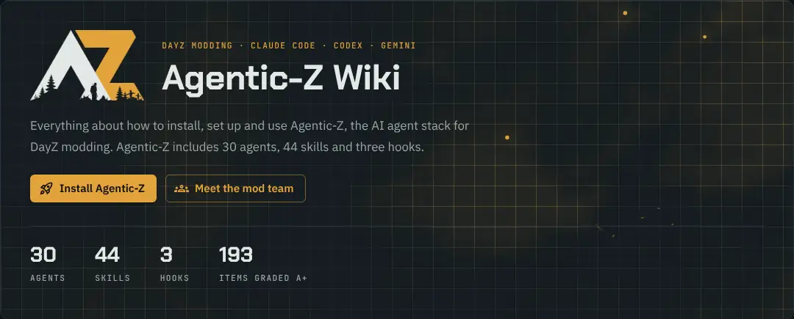

# Agentic-Z

<a href="https://github.com/DayZ-n-Chill/Agentic-Z"></a>

**An AI Agent Stack for DayZ Modding** — clone it, and your repo comes pre-loaded with specialist agents, slash commands, and a local RAG index that turn Claude Code, Codex, or Gemini CLI into a competent DayZ modding co-author.

---

## What you get

- **A 30-agent mod team**: an orchestrator that plans and tracks a whole mod, a Haiku router that picks the handler for a request, team leads, specialists for scripts, configs, models, textures, UI, Figma, maps, server admin, Workbench plugins, saving data, AI, vehicles, weapons, wearables, animation, audio and effects, and physics, and gatekeepers that review, build and test every task in game before you see it.
- **44 slash-command skills** (40 in the plugin, plus 4 clone-only template-maintenance skills) that drive DayZ Tools end-to-end — preflight, scaffold, build PBOs, launch a local diag server + client, manage `types.xml`, scope the agent to a single mod, etc.
- **A semantic-search RAG** over the vanilla DayZ source (Enforce Script, configs, layouts, materials), exposed through the `dayz-rag` MCP server to the specialists, reviewer, debugger, architect and layout agents. Embeddings via Voyage AI (`voyage-code-3`) stored in LanceDB; needs `VOYAGE_API_KEY` in `.env`. Skip the build with `/dayz-search-download`, which pulls the prebuilt index from GitHub releases.
- **Three-CLI support out of the box.** The same skills and rules files work in Claude Code, Codex CLI, and Gemini CLI. One `sync-skills` run wires the skills up in all three. The agents, hooks and RAG server are Claude Code only.

---

## Quick start

There are two ways to use Agentic-Z. Pick one — running both side-by-side will load every skill twice (once unprefixed, once as `agentic-z:<name>`).

**Option A — Clone as a template** (recommended for starting a new mod project):

```cmd
git clone <this-repo> my-dayz-mod
cd my-dayz-mod
python .claude\skills\sync-skills\sync.py
```

That symlinks the repo's `.claude/skills/` into the Codex and Gemini home directories so they discover the same slash commands Claude Code reads from the repo directly. Inside Claude Code you can also run `/sync-skills` instead. Skills appear unprefixed (`/dayz-build-pbo`).

**Option B — Install as a Claude Code plugin** (for adding the toolkit to an existing project without forking):

```text
/plugin marketplace add DayZ-n-Chill/Agentic-Z
/plugin install agentic-z@dayz-n-chill
```

Skills appear with the `agentic-z:` prefix (`/agentic-z:dayz-build-pbo`). The `dayz-rag` MCP server registers automatically.

To install a branch other than `main`, add the marketplace with the branch after a `#`: `/plugin marketplace add https://github.com/DayZ-n-Chill/Agentic-Z.git#develop`. Install from GitHub, not from a local clone folder. The installer copies a local folder whole, including the Windows links a test server (`.server/<instance>/`) or an imported mod creates, and without Windows Developer Mode that copy fails with `EPERM: operation not permitted, symlink`. A clone does not need the plugin anyway: it already has every agent and skill (Option A).

Then, from your mod project in Claude Code:

```text
/dayz-init
```

That's it. The wizard asks what you're doing (new mod or import), the mod name, which map to test on, and whether to build and launch. It fixes what it can on its own (mounting `P:\`, the `P:\Mods` junction) and gives you the fix or a steam:// link for the rest. Every run after the first shows a status hub for the active mod (PBO age, test servers, whether DayZ Diag is running, search status) and runs the next action you pick. To work on another mod, pick "Set up or switch to another mod" in the hub. Its state lives per clone in `.claude/local-memory/` (gitignored).

Power users can still call individual skills directly: `/dayz-preflight`, `/dayz-build-pbo`, `/dayz-launch-test`, etc. See the full slash-command list further down.

Full prerequisites, env-var overrides, and troubleshooting: **[`docs/dayz-modding.md`](docs/dayz-modding.md)**.

---

## Prerequisites (one-time, per machine)

| What | Why |
|---|---|
| **DayZ** (Steam) | The diag client (`DayZDiag_x64.exe`) ships next to retail and is what `/dayz-launch-test` runs. |
| **DayZ Tools** (Steam, free) | AddonBuilder, P-drive mounting, ImageToPAA. |
| **DayZ Server** (Steam, appid 223350) | Only for the initial mission template bootstrap; can be uninstalled afterward. |
| **`P:\` mounted** | Engine and Tools both read from `P:\`. Mount via DayZ Tools or `/dayz-workdrive`. Doesn't auto-mount across reboots. |
| **`P:\Mods\` junction → `<DayZ install>\!Workshop\`** | One-time `mklink /J` so built PBOs land where the engine actually loads mods. |
| **Vanilla data on `P:\`** | DayZ Tools → "Extract Game Data". Your configs inherit from vanilla classes such as `Inventory_Base` and `Clothing`, and your scripts from `ItemBase`. |
| **Python 3.10+** on `PATH` | The skills are Python scripts. |

Search (optional) embeds through Voyage AI's hosted API (`voyage-code-3`, code-tuned, 1024-dim) and stores the vectors in LanceDB under `~/.claude/dayz-search-index/`, where the `dayz-rag` MCP server reads them. Install its Python packages once from the repo root with `pip install -r .claude\mcp\dayz-rag\requirements.txt -r .claude\skills\dayz-search-index\requirements.txt`. Add `VOYAGE_API_KEY=pa-…` to `.env` at the repo root; queries need it either way. The last full local build with `/dayz-search-index` (August 2026, before windowing) embedded about 52,000 chunks and about 66M tokens; the current indexer makes about 62,000 chunks, and its local estimate of about 96M tokens runs high, so check Voyage's pricing first. To skip the build, `/dayz-search-download` installs the prebuilt index from GitHub releases with no embedding cost.

---

## Architecture — three tiers

| Tier | Scope | Where it lives |
|---|---|---|
| **L1 — Default rules** | Every clone, every agent, every skill. | `CLAUDE.md` / `AGENTS.md` / `GEMINI.md` (same content; one filename per CLI) |
| **L2 — DayZ conventions** | When working inside the DayZ domain. | `.claude/skills/_shared/dayz-conventions.md` (core, read by every DayZ agent) plus topic files in `.claude/skills/_shared/conventions/` (config, assets, scripts, ui, server) loaded per task |
| **L3 — Specific agent / skill** | The unit of work. | `.claude/agents/<name>.md` or `.claude/skills/<name>/SKILL.md` |

L3 files reference L2 in one line. The more specific tier wins ties. Corrections you give the team go into the right tier through `/dayz-record-correction`.

---

## Repo layout

```
<repo>/
├── .claude/
│   ├── agents/             # 30 agents: mod team, router, specialists, agent-creator (L3)
│   ├── skills/             # 44 slash-command skills (L3) + L2 shared conventions
│   │   ├── _shared/dayz-conventions.md   # L2 core
│   │   ├── _shared/conventions/          # L2 topic files (config, assets, scripts, ui, server)
│   │   ├── sync-skills/    # bootstrap: link skills into Claude/Codex/Gemini home dirs
│   │   └── dayz-*/         # one folder per DayZ skill
│   ├── mcp/dayz-rag/       # local RAG MCP server (search_dayz_source, get_dayz_file, ...)
│   ├── agent-memory/       # gitignored, per-agent memory written at runtime
│   ├── local-memory/       # gitignored, per-clone: user/machine notes and /dayz-init state
│   └── settings.local.json # gitignored, per-clone Claude Code settings
├── CLAUDE.md / AGENTS.md / GEMINI.md   # L1 rules (one per CLI, same content)
├── docs/                   # deep docs (DayZ workflow, model routing)
├── mods/agentic-z-panel/   # Claude Code panel plugin (one-click DayZ buttons)
├── workspace/              # in-progress mods (workspace/<ModName>/)
├── .server/                # local test-server instances (.server/<instance>/)
└── output/                 # one-shot deliverables
```

---

## DayZ skills (slash commands)

Most skills gate on `/dayz-preflight` first per L2 conventions. Exceptions, each with its reason, are listed in `.claude/skills/_shared/dayz-conventions.md`: `/dayz-stop-test` (escape hatch that must work even when the environment is broken), `/dayz-scope-mod` and `/dayz-record-correction` (they edit settings or rule files, not DayZ content), `/dayz-init` (runs preflight inside its own steps), `/dayz-workdrive` (it mounts the `P:\` that preflight checks), `/dayz-preflight` itself, `/dayz-gate` (it gates through the scripts it runs), `/dayz-search-download` (it only downloads a prebuilt index into `~/.claude/` and never reads or writes `P:\`), `/dayz-ask` (it only reads vanilla files and checks itself that `P:\` is mounted), the skills that only read files and write reports (`/dayz-lint`, `/dayz-balance`, `/dayz-conflict-check`, `/dayz-recipe`, `/dayz-layout-preview`, `/dayz-upgrade-guard`, `/dayz-release-pack`, `/dayz-server-kit`, `/dayz-health`, `/dayz-logwatch`), `/dayz-route` and `/dayz-statusline`.

### Front door

| Command | Purpose |
|---|---|
| [`/dayz-init`](.claude/skills/dayz-init/SKILL.md) | Setup wizard on first run; status hub for the active mod on every run after. Dispatches to the other skills, never replaces them. |

### Bootstrap (one-time per machine)

| Command | Purpose |
|---|---|
| [`/dayz-preflight`](.claude/skills/dayz-preflight/SKILL.md) | Verify env (P:\ mounted, Tools installed, vanilla data extracted). |
| [`/dayz-workdrive`](.claude/skills/dayz-workdrive/SKILL.md) | Mount `P:\` without opening DayZ Tools. |
| [`/dayz-setup-objectbuilder`](.claude/skills/dayz-setup-objectbuilder/SKILL.md) | One-time machine setup for Object Builder. |

### Mod scaffolding

| Command | Purpose |
|---|---|
| [`/dayz-new-mod`](.claude/skills/dayz-new-mod/SKILL.md) | Scaffold `workspace/<ModName>/` + `P:\<ModName>\` junction. |
| [`/dayz-import-mod`](.claude/skills/dayz-import-mod/SKILL.md) | Symlink an existing mod folder into the workspace + create the junction. Source folder is never moved. |
| [`/dayz-add-scaffold`](.claude/skills/dayz-add-scaffold/SKILL.md) | Add missing scaffold pieces (config.cpp stub, gproj, etc.) to an existing mod folder; `--piece junction` repairs a missing `P:\<ModName>\` link. |
| [`/dayz-recipe`](.claude/skills/dayz-recipe/SKILL.md) | Start a plan from a recipe (new weapon, new vest, new craftable): classes, vanilla parents checked on `P:\`, files, tasks per team and behavior checks, for `dayz-mod-architect` to finish. |
| [`/dayz-scope-mod`](.claude/skills/dayz-scope-mod/SKILL.md) | Lock the agent to one mod via deny rules so it can't clobber siblings. |

### Build

| Command | Purpose |
|---|---|
| [`/dayz-build-pbo`](.claude/skills/dayz-build-pbo/SKILL.md) | Pack and deploy to `P:\Mods\@<ModName>\Addons\<ModName>.pbo`. |
| [`/dayz-deploy-pbo`](.claude/skills/dayz-deploy-pbo/SKILL.md) | Copy prebuilt PBOs and keys from a workspace bundle to `P:\Mods\@<ModName>\` without AddonBuilder. |
| [`/dayz-pack-texture`](.claude/skills/dayz-pack-texture/SKILL.md) | PNG/TGA → `.paa` via ImageToPAA. Validates the suffix against the vanilla set (`_co`, `_ca`, `_nohq`, `_smdi`, `_as`, `_mc` and more). |
| [`/dayz-build-imageset`](.claude/skills/dayz-build-imageset/SKILL.md) | Pack `.gui-sources/<setname>/*.png` into a DayZ `.imageset` + `.paa` atlas with a 10px gutter; auto-splits into multiple parts when sprites won't fit in 4096x4096. |
| [`/dayz-layout-preview`](.claude/skills/dayz-layout-preview/SKILL.md) | Draw a `.layout` as PNGs at several screen sizes and flag widgets that fall off screen or have no area. |

### Test loop

| Command | Purpose |
|---|---|
| [`/dayz-add-server`](.claude/skills/dayz-add-server/SKILL.md) | Set up a test server instance under `.server/<instance>/`. |
| [`/dayz-launch-test`](.claude/skills/dayz-launch-test/SKILL.md) | Local diag server + client with mod loaded. |
| [`/dayz-stop-test`](.claude/skills/dayz-stop-test/SKILL.md) | Kill running `DayZDiag_x64.exe` processes. Escape hatch (no preflight gate). |
| [`/dayz-cot-bootstrap`](.claude/skills/dayz-cot-bootstrap/SKILL.md) | Two-pass workflow to grant COT admin perms on a fresh test instance. |
| [`/dayz-logwatch`](.claude/skills/dayz-logwatch/SKILL.md) | Watch a test session's server and client logs and triage each new error line as it appears: a known error prints its fix and owner, a new one goes to `dayz-mod-debugger`. |

### Gates, routing and status

| Command | Purpose |
|---|---|
| [`/dayz-gate`](.claude/skills/dayz-gate/SKILL.md) | Run the build, in-game, behavior and visual gates as scripts: build or deploy, launch, read the new log lines, run a test mission that spawns and uses each new item, compare screenshots with stored baselines, triage failures against known errors. |
| [`/dayz-lint`](.claude/skills/dayz-lint/SKILL.md) | Find errors that would stop a mod loading, before packing, with `file:line` and an owner for each; runs first inside `/dayz-gate build` and `/dayz-build-pbo`. |
| [`/dayz-conflict-check`](.claude/skills/dayz-conflict-check/SKILL.md) | Find `$PBOPREFIX$`, path and class name collisions with CF, COT and Expansion from their configs and PBO headers, without extracting them; `--ingame` then runs the in-game gate with them loaded. |
| [`/dayz-upgrade-guard`](.claude/skills/dayz-upgrade-guard/SKILL.md) | Snapshot vanilla classes before a DayZ update, then list the mod classes whose vanilla parents changed and optionally rebuild the search index. |
| [`/dayz-balance`](.claude/skills/dayz-balance/SKILL.md) | Compare item stats (weight, health, damage, protection, capacity, quantity) with similar vanilla items on `P:\DZ\` and flag outliers with `file:line`. |
| [`/dayz-route`](.claude/skills/dayz-route/SKILL.md) | Pick the skill, agent or team for a request with keyword rules first; prints one JSON decision and says when the `dayz-router` agent is needed. |
| [`/dayz-statusline`](.claude/skills/dayz-statusline/SKILL.md) | Install a status line showing `P:\` mount, active mod, running diag session and search-index age; `--remove` undoes it. |
| [`/dayz-health`](.claude/skills/dayz-health/SKILL.md) | Write a mod's health page from the stored gate results: last build, last test, open findings and the history of every gate run. |

### Editors

| Command | Purpose |
|---|---|
| [`/dayz-launch-workbench`](.claude/skills/dayz-launch-workbench/SKILL.md) | Open Enfusion Workbench (script + UI editor) detached. |
| [`/dayz-launch-objectbuilder`](.claude/skills/dayz-launch-objectbuilder/SKILL.md) | Open Object Builder (`.p3d` editor) detached. |

### Loot economy (`types.xml`)

| Command | Purpose |
|---|---|
| [`/dayz-edit-types`](.claude/skills/dayz-edit-types/SKILL.md) | Programmatically upsert a single `<type>` in `types.xml`. |
| [`/dayz-split-types`](.claude/skills/dayz-split-types/SKILL.md) | Split monolithic `types.xml` into per-category files and point `cfgeconomycore.xml` at them. |

### Release

| Command | Purpose |
|---|---|
| [`/dayz-release-pack`](.claude/skills/dayz-release-pack/SKILL.md) | Write the Workshop description, a changelog entry from the mod's history, the classname list and server owner install notes in one go. |
| [`/dayz-server-kit`](.claude/skills/dayz-server-kit/SKILL.md) | Zip the `types.xml` entries, `cfgeconomycore.xml` lines, load order and the public `.bikey` for server owners. Never packs a `.biprivatekey`. |

### Specialist tools (deep)

| Command | Purpose |
|---|---|
| [`/dayz-p3d-audit`](.claude/skills/dayz-p3d-audit/SKILL.md) | Audit `.p3d` models for collision, action targeting, physics, animation issues. |
| [`/dayz-particles`](.claude/skills/dayz-particles/SKILL.md) | Particle effect creation (`.ptc` / `.emat`) without Workbench. |

### Search / RAG

| Command | Purpose |
|---|---|
| [`/dayz-search-download`](.claude/skills/dayz-search-download/SKILL.md) | Pull prebuilt vector index from GitHub releases (recommended fast path). |
| [`/dayz-search-index`](.claude/skills/dayz-search-index/SKILL.md) | Build the vanilla-source semantic-search index yourself (requires `VOYAGE_API_KEY`). |
| [`/dayz-ask`](.claude/skills/dayz-ask/SKILL.md) | Answer a plain English question about vanilla DayZ with `path:line` citations checked against `P:\`; falls back to a keyword search when there is no index or key. |

### Team rules

| Command | Purpose |
|---|---|
| [`/dayz-record-correction`](.claude/skills/dayz-record-correction/SKILL.md) | Turn your correction of the mod team into a written rule in the right tier. |

### Cleanup

| Command | Purpose |
|---|---|
| [`/dayz-clean-workspace`](.claude/skills/dayz-clean-workspace/SKILL.md) | Remove DayZ scaffolds and their deployed artifacts. |

### Claude Code panel (separate plugin)

| Plugin | Purpose |
|---|---|
| [`agentic-z-panel`](mods/agentic-z-panel/) | Panel beside the chat with DayZ state and one-click Mount, Build, Check, Deploy, Launch, Stop, Workbench, Object Builder, test logs, health page and release pack buttons, plus an ask field for vanilla questions, that run the skill scripts directly. Install with `/plugin install agentic-z-panel@dayz-n-chill`, open with `/dayz-panel`. |

### Template maintenance (clone-only, not in plugin marketplace)

| Command | Purpose |
|---|---|
| [`/sync-skills`](.claude/skills/sync-skills/SKILL.md) | Link `.claude/skills/` into each agent CLI's home dir. Required after clone. |
| [`/agentic-z-update`](.claude/skills/agentic-z-update/SKILL.md) | Pull upstream template improvements into your clone without touching `workspace/`. |
| [`/docs-sync`](.claude/skills/docs-sync/SKILL.md) | Check the React wiki (its own private repo, `DayZ-n-Chill/Agentic-Z-Wiki`, cloned next to this one) against the source: every agent and skill is listed, counts match the repo and the grade files, and each graded item appears once in the grades tables; `--apply` updates only those computed counts. |
| [`/clean-repo`](.claude/skills/clean-repo/SKILL.md) | Repo-wide cleanup orchestrator across every domain. |

---

## The mod team

For a whole mod, start the orchestrator as your main session: `claude --agent agentic-z:dayz-orchestrator` (or `claude --agent dayz-orchestrator` inside a clone). It has the architect plan the mod, waits for your yes, then hands tasks to team leads. Every task passes the mod reviewer (and the layout check for UI work) inside its team. After each wave, the orchestrator builds the mod and loads it in game, one test session at a time. When a gate fails, the debugger reads the logs and the task goes back to its worker.

| Agent | Role |
|---|---|
| [`dayz-orchestrator`](.claude/agents/dayz-orchestrator.md) | Plans the build with you, splits it into tasks, tracks it to a test build. |
| [`dayz-router`](.claude/agents/dayz-router.md) | Haiku agent that picks one handler for a request when `/dayz-route` has no confident match. |
| [`dayz-mod-architect`](.claude/agents/dayz-mod-architect.md) | Designs the mod's classes, files and task list before work starts. |
| [`dayz-lead`](.claude/agents/dayz-lead.md) | Runs one team (script, config, art, UI, server, release) and its gates. |
| [`dayz-build-checker`](.claude/agents/dayz-build-checker.md) | Gate: the PBO builds with no AddonBuilder errors. |
| [`dayz-ingame-tester`](.claude/agents/dayz-ingame-tester.md) | Gate: the mod loads on a diag server and client with clean logs. |
| [`dayz-build-engineer`](.claude/agents/dayz-build-engineer.md) | Builds, launches test sessions and deploys after your yes. |
| [`dayz-docs-writer`](.claude/agents/dayz-docs-writer.md) | Keeps the mod's README, changelog and classname list current, and writes the Workshop text and server kit with `/dayz-release-pack` and `/dayz-server-kit`. |

You can still call any specialist below directly for a single task.

## DayZ specialist agents

| Agent | Focus |
|---|---|
| [`dayz-script-specialist`](.claude/agents/dayz-script-specialist.md) | Enforce Script — modded classes, RPCs, replication, gameplay logic. |
| [`dayz-config-specialist`](.claude/agents/dayz-config-specialist.md) | `config.cpp`, CfgPatches, CfgVehicles, inheritance, hidden selections. |
| [`dayz-asset-specialist`](.claude/agents/dayz-asset-specialist.md) | `.p3d` / `.paa` / `.rvmat` and Workbench asset integration. |
| [`dayz-object-builder`](.claude/agents/dayz-object-builder.md) | `.p3d` LODs, named selections, geometry, damage zones. |
| [`dayz-map-specialist`](.claude/agents/dayz-map-specialist.md) | Terrain Builder, DayZ Editor, map objects, clutter, surfaces. |
| [`dayz-ui-specialist`](.claude/agents/dayz-ui-specialist.md) | `.layout` files, widget scripting, HUD/menu, UI theme. |
| [`dayz-server-admin`](.claude/agents/dayz-server-admin.md) | `types.xml`, `init.c`, `cfggameplay.json`, server performance. |
| [`dayz-mod-debugger`](.claude/agents/dayz-mod-debugger.md) | Log/RPT/crash analysis, BattlEye diagnosis, performance profiling. |
| [`dayz-mod-reviewer`](.claude/agents/dayz-mod-reviewer.md) | Audit `workspace/<ModName>/` for convention compliance; routes findings. |
| [`dayz-workbench-specialist`](.claude/agents/dayz-workbench-specialist.md) | Workbench plugin development (editor-time tooling). |
| [`dayz-persistence-specialist`](.claude/agents/dayz-persistence-specialist.md) | Data that survives a server restart: `OnStoreSave` and `OnStoreLoad`, save versions, base building, the data audit before release. Script lead. |
| [`dayz-ai-specialist`](.claude/agents/dayz-ai-specialist.md) | Infected, animals and human AI such as patrols and guards, written from scratch. Script lead. |
| [`dayz-vehicle-specialist`](.claude/agents/dayz-vehicle-specialist.md) | Cars, boats and helicopters: engine, gearbox, wheels, doors, fluids, seats and damage. Config lead. |
| [`dayz-weapon-specialist`](.claude/agents/dayz-weapon-specialist.md) | Weapons, magazines, ammo, attachments, recoil and fire modes. Config lead. |
| [`dayz-wearables-specialist`](.claude/agents/dayz-wearables-specialist.md) | Clothing, characters, inventory slots, protection, color variants and proxies. Art lead. |
| [`dayz-animation-specialist`](.claude/agents/dayz-animation-specialist.md) | `model.cfg` animations, RTM files and the Blender handoff. Art lead. |
| [`dayz-audio-fx-specialist`](.claude/agents/dayz-audio-fx-specialist.md) | Sound shaders, sound sets and particle effects. Any lead. |
| [`dayz-physics-specialist`](.claude/agents/dayz-physics-specialist.md) | Weight, collision LODs, dropping, throwing and contact. Any lead. |
| [`figma-node-normalizer`](.claude/agents/figma-node-normalizer.md) | Cleans a Figma frame so it can be converted. |
| [`figma-to-dayz-layout`](.claude/agents/figma-to-dayz-layout.md) | Turns a cleaned Figma frame into a DayZ `.layout`, and repairs one the validator failed. |
| [`dayz-layout-validator`](.claude/agents/dayz-layout-validator.md) | Checks generated `.layout` files without editing them; the UI gate. |

Plus [`agent-creator`](.claude/agents/agent-creator.md) for scaffolding new agent definitions.

---

## Default rules (L1) at a glance

The full text lives in `CLAUDE.md` / `AGENTS.md` / `GEMINI.md`.

- **Communication — answer first, caveat after.** Deliver the underlying answer via available tools; mention any limitation as a one-liner *after*, never as the lead.
- **Tooling — pick the fastest tool for the job.** Default Python; `cmd`/`.bat` for trivial Windows wrappers; PowerShell only when explicitly asked or genuinely faster; prefer dedicated `Read` / `Edit` / `Write` / `Grep` / `Glob`.
- **Doc maintenance — plain copies.** Edit `CLAUDE.md` / `AGENTS.md` / `GEMINI.md` together.
- **Bootstrap — `/sync-skills` after cloning.** Required so Codex and Gemini see the slash commands.
- **Memory — `local-memory/` only, never for rules.** User/machine-specific notes only; rules go in the repo.
- **Subagent routing for DayZ work — route cheaply first.** Run `/dayz-route` on a new DayZ request, and ask the `dayz-router` agent when it returns `"next": "dayz-router"`. Dispatch the matching `dayz-*` specialist instead of a generic Superpowers agent. The Figma-to-DayZ pipeline is `figma-node-normalizer`, then `figma-to-dayz-layout`, then `dayz-layout-validator`. Role-to-specialist table in [`docs/dayz-modding.md`](docs/dayz-modding.md).

---

## Documentation

- **[`docs/README.md`](docs/README.md)** — architecture overview, how to add skills/agents, local-memory rules.
- **[`docs/dayz-modding.md`](docs/dayz-modding.md)** — full DayZ workflow, prerequisites, env vars, troubleshooting.
- **[`docs/model-routing.md`](docs/model-routing.md)** — when to use Opus / Sonnet / Haiku and the subagent patterns.
- **[`docs/evals.md`](docs/evals.md)**: answer tests that score each agent's answers, so a change can only keep or raise the score.
- **[`docs/prompt-conventions.md`](docs/prompt-conventions.md)** — why agent and skill files use caps the way they do (RFC 2119 directives, when to cap, when to stay lowercase).
- **The wiki** lives in its own private repo, `DayZ-n-Chill/Agentic-Z-Wiki` (React + MUI, Vite). `/docs-sync` checks it against this repo when it is cloned next to this one. The old Docusaurus wiki is archived in that repo too, under `archive/wiki-docusaurus/`.

---

## Adding things

**A new skill:** create `.claude/skills/my-skill/`, add `SKILL.md` with `name`/`description` frontmatter and a "How to run" section, drop the script in. Run `/sync-skills` to make it discoverable in all agent CLIs.

**A new agent CLI:** append an entry to `.claude/skills/sync-skills/agents.json` and run `/sync-skills`. The new home gets links for every skill automatically.

---

## Community & contributing

**Join us on Discord: [discord.gg/dayznchill](https://discord.gg/dayznchill)**

Agentic-Z is built by and for the DayZ modding community, and contributions are **highly encouraged**. Every agent, skill, and convention in this repo started as a real problem someone hit while shipping a mod — the more modders contribute, the sharper the toolkit gets for everyone.

In the Discord you can:

- **Learn how to become a contributor.** New contributors are walked through the repo layout, the L1/L2/L3 rule structure, and how to land a first PR.
- **Propose new agents and skills.** If you keep solving the same problem by hand, that's a skill waiting to be written. Pitch it in Discord and we'll help shape it.
- **Report bugs and rough edges.** Path resolution quirks, AddonBuilder errors, agent prompts that miss the mark — all welcome.
- **Share what you've built.** Mods, server setups, custom agents, RAG indexes over your own assets. The toolkit improves fastest when people show what they shipped with it.
- **Help refine and enhance the product.** Docs improvements, troubleshooting entries, better defaults, new MCP integrations — every contribution compounds.

Whether you're a seasoned Enforce Script developer, a server admin, a 3D artist, or just learning DayZ modding for the first time, there's a place for your work here. The goal is a tool that makes DayZ modding accessible and enjoyable for everyone — and that only happens with community input.

---

## Security baseline

The shipped configuration is the security baseline. **Tighten it for your environment, never loosen it without thinking.**

- **`.claude/settings.json`** (committed) — narrow Bash allowlist limited to running this repo's own skills (`Bash(python .claude/skills/*)`, `Bash(npm list *)`, etc.) plus an explicit deny list that blocks the dangerous escape hatches: `Bash(python -c *)`, `Bash(python -m *)`, `Bash(node -e *)`, `Bash(node -p *)`, `Bash(npm install *)`, `Bash(npx *)`. Editing this file affects every clone — keep allows narrow and prefer deny rules over removing them.
- **`.claude/settings.local.json`** (gitignored, per-clone) — your machine-specific overrides. **Never set `dangerouslySkipPermissions: true` in a long-lived clone**; it bypasses every prompt including the deny list. Use `/fewer-permission-prompts` to build a real allowlist incrementally as you hit prompts.
- **`.claude/agents/*.md`** — every agent declares an explicit `tools:` allowlist. Auditor/diagnostic agents cannot Edit/Write: `dayz-mod-debugger` also has no Bash, and `dayz-mod-reviewer` gets Bash only to run `/dayz-lint`. The two run-only gates (`dayz-build-checker`, `dayz-ingame-tester`) and `dayz-build-engineer` get Bash and Skill to run the build and test skills but no Edit/Write. `dayz-layout-validator` gets Bash and Skill to run the layout syntax check and preview but no Edit/Write; repairs go to `figma-to-dayz-layout`. `dayz-lead` can only read and start agents; `dayz-orchestrator` has the broadest list (including Bash and Agent) because it runs as your main session. Authoring specialists get Read/Write/Edit/Glob/Grep plus the `dayz-rag` MCP tools; `dayz-asset-specialist`, `dayz-object-builder`, `dayz-server-admin` and `dayz-ui-specialist` also get Bash and Skill, to run the texture, model, types.xml, imageset and layout preview skills; `dayz-script-specialist`, `dayz-persistence-specialist`, `dayz-vehicle-specialist`, `dayz-weapon-specialist` and `dayz-wearables-specialist` also get Bash and Skill, to run `/dayz-lint` on the mod's scripts (and `/dayz-particles` for weapons). `dayz-physics-specialist` gets Bash and Skill without Edit or Write, to run the model audit. `dayz-docs-writer` gets Read/Write/Edit/Glob/Grep for the docs plus Bash and Skill, used only to run `/dayz-release-pack` and `/dayz-server-kit` and a few read only `git status` and `git log` commands. None of the DayZ agents has network tools. The exceptions are `agent-creator`, which has WebFetch to read the official subagent spec, and `figma-node-normalizer`, which reads Figma through the Figma MCP server's read-only tools. Subagents inherit only what's listed — no implicit full-toolset escalation.

If you fork the repo to publish a downstream variant, run `git diff main -- .claude/settings.json .claude/agents/` before pushing and convince yourself any widened permissions are intentional.

---

## License

See [`LICENSE`](LICENSE). Copyright (c) 2026 DayZ n' Chill. Free to use for developing DayZ modifications.
