Agentic-Z Guide

# Agentic-Z Guide

This guide explains how to install, set up and use Agentic-Z, the AI agent stack for DayZ modding. Agentic-Z includes 30 agents, 44 skills, three hooks and a side panel.

## Contents

- [What Agentic-Z is](#what-agentic-z-is)
    - [What it includes](#what-it-includes)
    - [Which AI tools it works with](#which-ai-tools-it-works-with)
    - [How it fits together](#how-it-fits-together)
- [Before you start](#before-you-start)
    - [What you need](#what-you-need)
    - [Optional extras](#optional-extras)
- [Install and first setup](#install-and-first-setup)
    - [Option A: clone as a template](#option-a-clone-as-a-template)
    - [Option B: install as a Claude Code plugin](#option-b-install-as-a-claude-code-plugin)
    - [Run the setup wizard](#run-the-setup-wizard)
- [Your daily loop](#your-daily-loop)
- [Agents](#agents)
    - [All agents](#all-agents)
- [The mod team](#the-mod-team)
    - [Team structure](#team-structure)
    - [Starting the team](#starting-the-team)
    - [How the team checks work](#how-the-team-checks-work)
- [RAG search](#rag-search)
- [The three tiers of rules](#the-three-tiers-of-rules)
    - [Token savers](#token-savers)
    - [Each specialist in detail](#each-specialist-in-detail)
    - [How each specialist works](#how-each-specialist-works)
    - [How every specialist's knowledge is checked](#how-every-specialists-knowledge-is-checked)
    - [Paste it in](#paste-it-in)
- [Add-ons (planned)](#add-ons-planned)
- [How the grading works](#how-the-grading-works)
    - [The final count](#the-final-count)
    - [Who grades](#who-grades)
    - [What they grade against](#what-they-grade-against)
    - [The rubric for agents and skills](#the-rubric-for-agents-and-skills)
    - [The rubric for everything else](#the-rubric-for-everything-else)
    - [The scale](#the-scale)
    - [Run it yourself](#run-it-yourself)
    - [Quality by version](#quality-by-version)
- [Why each item got its grade](#why-each-item-got-its-grade)
    - [Real bugs the grading found and fixed](#real-bugs-the-grading-found-and-fixed)
    - [Every skill](#every-skill)
- [Where everything lives](#where-everything-lives)
    - [Folders](#folders)
    - [Settings you might need](#settings-you-might-need)
- [Safety](#safety)
- [Troubleshooting](#troubleshooting)
- [FAQ](#faq)
- [Getting help and contributing](#getting-help-and-contributing)

## What Agentic-Z is

Agentic-Z turns Claude Code into a DayZ modding partner. It provides specialist agents for DayZ, slash commands that run DayZ Tools for you, house rules that keep mods clean, and a search over the vanilla game files. With that search, the AI looks up facts instead of guessing.

### What it includes

#### Specialists

- Scripts, configs and UI
- Models and textures
- Maps and servers
- Saved data and AI
- Vehicles and weapons
- Wearables and animation
- Audio, effects and physics
- Review and debugging

#### Skills

- Setup wizard
- Lint and PBO builds
- Test launches and gates
- types.xml
- Textures and layouts
- Release pack

#### RAG search

- Vanilla scripts
- Configs
- Layouts
- Materials

### Which AI tools it works with

| AI tool | What it gets |
| --- | --- |
| Claude Code | Everything |
| Codex CLI | Skills and rules files |
| Gemini CLI | Skills and rules files |

The agents, the hooks and RAG search work only in Claude Code. Codex CLI and Gemini CLI get the skills, which `/sync-skills` links into all three tools, and the rules files, which are `AGENTS.md` and `GEMINI.md`.

### How it fits together

You work with your AI tool. Agentic-Z gives that tool rules, agents, skills and a search server. Together, these act on your mod folder, the P: drive, DayZ Tools and the game.


## Before you start

### What you need

| Requirement | Purpose |
| --- | --- |
| Windows | DayZ Tools and the P: drive run only on Windows. |
| DayZ (Steam) | The diag client ships with the game and runs your tests. |
| DayZ Tools (Steam, free) | Provides AddonBuilder, P: drive mounting and ImageToPAA. |
| DayZ Server (Steam) | `/dayz-add-server` copies its mission into each new test instance, and again with `--refresh-mission`. |
| P: mounted, with vanilla data extracted | Configs inherit from the vanilla classes on P:. |
| Python 3.10+ on PATH | The skills are Python scripts. |
| Claude Code (or Codex CLI or Gemini CLI) | Your AI tool (see [What Agentic-Z is](#what-agentic-z-is)). |

### Optional extras

The core runs on DayZ Tools, the vanilla game files, Python and Claude Code. Some features need more:

- RAG search needs a Voyage AI key. Install its Python packages with `pip install -r .claude\mcp\dayz-rag\requirements.txt`. To build the index, also install `.claude\skills\dayz-search-index\requirements.txt`. Then add `VOYAGE_API_KEY=pa-...` to `.env` at the repository root.
- The Figma pipeline needs a Figma MCP server.
- `/dayz-p3d-audit` needs py3d.
- `/dayz-build-imageset`, `/dayz-layout-preview` and `/dayz-gate visual` need Pillow.
- `/dayz-cot-bootstrap` needs the CF and COT mods.

## Install and first setup



Choose one installation option only. If you install both the clone and the plugin, every skill loads twice.

### Option A: clone as a template

Use this option to start a new mod project.

```
git clone https://github.com/DayZ-n-Chill/Agentic-Z.git my-dayz-mod
cd my-dayz-mod
python .claude\skills\sync-skills\sync.py
```

### Option B: install as a Claude Code plugin

Use this option to add Agentic-Z to an existing project.

```
/plugin marketplace add DayZ-n-Chill/Agentic-Z
/plugin install agentic-z@dayz-n-chill
```

Plugin skills appear with an `agentic-z:` prefix, for example `/agentic-z:dayz-build-pbo`.

### Run the setup wizard

```
/dayz-init
```

The wizard asks whether you are starting a new mod or importing one, the mod name, which map to test on, and whether to build and launch. It fixes what it can, such as mounting P: and creating the `P:\Mods` link, and explains how to fix the rest. On every later run, it shows a status hub for your active mod.

## Your daily loop



1. Ask an agent for the change, for example "add a hidden selection for the camo".
2. Run `/dayz-build-pbo <ModName>` to pack the mod into `P:\Mods\@<ModName>\Addons\`.
3. Run `/dayz-launch-test <ModName> --server <instance>` to start a diag server and client with your mod loaded.
4. Check the logs, or hand them to `dayz-mod-debugger`.
5. Run `/dayz-stop-test` to close DayZ. Fix any problems and repeat.

## Agents

Describe what you want, and Claude picks the right specialist. You can also name an agent directly, for example "use the dayz-config-specialist to...".

### All agents

| Agent | What it does | Example request |
| --- | --- | --- |
| `dayz-script-specialist` | Writes Enforce Script: modded classes, RPCs and game logic. | "Make my medkit heal over 30 seconds." |
| `dayz-config-specialist` | Writes config.cpp, CfgPatches, inheritance and hidden selections. | "Write the CfgVehicles entry for my vest." |
| `dayz-asset-specialist` | Handles textures (.paa) and materials (.rvmat). | "Pack vest\_camo\_co.png and make an rvmat." |
| `dayz-object-builder` | Handles .p3d models: LODs, selections and Object Builder steps. | "Set up hidden selections on my vest model." |
| `dayz-ui-specialist` | Writes .layout files and HUD and menu scripts. | "Add a compass to the HUD." |
| `dayz-map-specialist` | Handles Terrain Builder, layers.cfg, surfaces and clutter. | "Export my base from DayZ Editor to Terrain Builder." |
| `dayz-server-admin` | Handles types.xml, events, init.c and cfggameplay. | "Make my vest spawn rarely in military zones." |
| `dayz-workbench-specialist` | Writes Workbench plugins (editor tools). | "A plugin that checks texture suffixes." |
| `dayz-mod-debugger` | Reads logs and crash files to find the cause of a failure. | "My server crashes on start, here is the RPT." |
| `dayz-mod-reviewer` | Audits a mod before you build and returns PASS or FAIL. | "Review workspace/MyVest before I build." |
| `figma-node-normalizer`, `figma-to-dayz-layout`, `dayz-layout-validator` | Optional. Turn a Figma frame into a .layout. The validator checks the result without editing it. | "Turn this Figma frame into a DayZ menu." |
| `dayz-orchestrator` and team | Plans a whole mod and runs the leads, workers and checks. | See [The mod team](#the-mod-team). |
| `dayz-mod-architect` | Plans a mod: classes, files, assets and a task list. | Started by the orchestrator. |
| `dayz-lead` | Runs one team (script, config, art, UI, server or release) and its review checks. | Started by the orchestrator. |
| `dayz-build-checker`, `dayz-ingame-tester` | Provide backup checks when `/dayz-gate` itself fails. | Started by the orchestrator. |
| `dayz-build-engineer` | Builds the PBO (or deploys a prebuilt bundle) and starts a test session. | "Build MyVest and start a test on chernarus." |
| `dayz-docs-writer` | Writes the mod README, changelog and classname list. | "Update the MyVest docs." |
| `dayz-persistence-specialist` | Saved data across restarts. See [Each specialist in detail](#each-specialist-in-detail). | "Make my safe keep its code and contents after a restart." |
| `dayz-ai-specialist` | Infected, animals and human AI. See [Each specialist in detail](#each-specialist-in-detail). | "Add guards that patrol my base and react to gunfire." |
| `dayz-vehicle-specialist` | Cars, boats and helicopters. See [Each specialist in detail](#each-specialist-in-detail). | "Add a four door pickup with a bigger fuel tank." |
| `dayz-weapon-specialist` | Weapons, magazines and ammunition. See [Each specialist in detail](#each-specialist-in-detail). | "Add a hunting rifle that takes a five round magazine." |
| `dayz-wearables-specialist` | Clothing, characters and inventory slots. See [Each specialist in detail](#each-specialist-in-detail). | "Make a plate carrier in three colors." |
| `dayz-animation-specialist` | model.cfg animations and RTM files. See [Each specialist in detail](#each-specialist-in-detail). | "Make my bunker doors open and close." |
| `dayz-audio-fx-specialist` | Sounds and particle effects. See [Each specialist in detail](#each-specialist-in-detail). | "Give my generator a running sound and exhaust smoke." |
| `dayz-physics-specialist` | Weight, collision and contact. See [Each specialist in detail](#each-specialist-in-detail). | "My crate falls through the floor. Fix it." |
| `dayz-router` | A low-cost Haiku agent that decides who handles a request. | Used by `/dayz-route`. |
| `agent-creator` | Writes and checks new agent files. | "Create an agent that reviews RPC security." |

## The mod team

### Team structure

- You
- Planning
- Team leads
- Workers (one per task)
- Gatekeepers
- Playbook and reference files


### Starting the team

To start the team after a plugin install, run `claude --agent agentic-z:dayz-orchestrator`. In a clone, run `claude --agent dayz-orchestrator`.

The orchestrator plans the mod with you and waits for your approval. It then runs the work in waves.

### How the team checks work

Checks happen at two levels. The leads run the mod review and the layout check on each task. The orchestrator runs the gates once per wave, one at a time, because there is only one mod folder and one test session. Workers run at the same time only when their tasks touch different files.

Each wave goes through these gates:

| Gate | What it does |
| --- | --- |
| Build check (`/dayz-gate build`) | Runs `/dayz-lint` first, then builds the mod and reports PASS or FAIL. |
| In-game test (`/dayz-gate ingame`) | Loads the mod in game, checks that the logs are clean and reports PASS or FAIL. |
| Behavior test (`/dayz-gate behavior`) | Runs only when `output\<ModName>-plan\behavior-checks.json` exists. A scripted test mission spawns and uses each new item and reports PASS or FAIL for each feature. |
| Visual check (`/dayz-gate visual`) | Takes screenshots during the in-game test and compares them with stored baselines. |

Nothing reaches you until the mod builds, loads in game with clean logs and, when the plan lists behavior checks, passes the behavior test.

The behavior and visual gates have been tested only with fixtures. They have not yet run in a live DayZ session.



## RAG search



| Tool | What it does |
| --- | --- |
| `search_dayz_source` | Searches vanilla scripts, configs, layouts and materials by meaning. |
| `get_dayz_file` | Opens an exact file and line range on P:. |
| `list_indexed_sources` | Shows what is indexed and when. |

Agents use Grep first when they know an exact class or symbol name. They use RAG search for questions by meaning. A search hit is only a lead until the agent opens the real file, so every answer includes `path:line` references you can check.

## The three tiers of rules


### Token savers

These features move mechanical work out of the AI. The AI then spends tokens only on work that needs judgment: planning, writing code and configs, review and real diagnosis.



| Feature | What it does | How to use it |
| --- | --- | --- |
| Script-only checks | Run the build and in-game checks with no AI involved, which saves tokens. | `/dayz-gate build <ModName>`, `/dayz-gate ingame <ModName>` |
| Log triage | Matches failures against 52 known errors, each with its fix and owner. Only new errors go to the debugger. | Runs inside `/dayz-gate`. Use `triage.py --learn` to add your own. |
| Router | Decides who handles a request: keyword rules first, then Jev, then a low-cost Haiku router. | `/dayz-route "<request>"` (the AI runs it first) |
| Edit hooks | Check `config.cpp` and `.layout` syntax after every edit, and block edits to other mods while a scope is set. | Automatic with the plugin or a clone. |
| Paste-in router | Reads what you paste and starts the matching workflow. | Automatic. See [Paste it in](#paste-it-in). |
| Status line | Shows the state of P:, the active mod, whether DayZ Diag is running and the age of the search index. | Run `/dayz-statusline` once per project. |
| Launcher panel | Adds a panel beside the chat. It has buttons to mount P:, build, run the build and in-game checks, deploy, launch, stop, open Workbench and Object Builder, view test logs, open the health page and create the release pack. It also has a field that sends questions to `/dayz-ask`. | Run `/plugin install agentic-z-panel@dayz-n-chill`, then `/dayz-panel`. |
| Lower-cost models | The build engineer and the router run on Haiku. The docs writer runs on Sonnet. | Automatic. |
| Smaller rules | The DayZ rules file is split into a 143-line core and five topic files of 24 to 56 lines. Most skills read only the core, which is 40% less than the old 239-line file. `/dayz-deploy-pbo` and `/dayz-gate` also read the bundle mods section of the config topic file. Each agent reads the core plus the topic files its job needs. With one topic file, an agent reads 17% to 30% less than before. With two, the result depends on which two. The mod debugger (226 lines) and the mod architect (231 lines) still read slightly less. The vehicle, weapon, and audio and effects specialists (251 lines) read more, as does the mod reviewer, which reads three topic files (283 lines). | Automatic. |
| No-token wrappers | Provide a `.bat` file for every runnable skill, so you can run it yourself with no AI involved. | See `scripts\README.md`. |
| Shorter descriptions | Every skill and agent description loads into every session. The descriptions were shortened to save about 2,100 tokens. | Automatic. |
### Each specialist in detail

In addition to the specialists for scripts, configs, art, UI, maps and servers, Agentic-Z includes specialists for saved data, vehicles, weapons, wearables, animation, audio, physics and AI. Each one works under a team lead and has its own reference pack. Every pack is checked against the vanilla game files, and a specialist loads its pack only when a task needs it. For the checks that run before a mod is packed, see [How the team checks work](#how-the-team-checks-work).



| `dayz-persistence-specialist` | Details |
| --- | --- |
| What it does | Makes modded items and systems keep their data across server restarts. It writes the save and load code (OnStoreSave and OnStoreLoad) and stamps every save with a version number. It also writes the upgrade path, so old saves still load after the mod changes. It covers base building parts that must survive restarts. Before release, it runs a data audit that confirms every saved field is written and read back in the same order. |
| Example request | "Make my safe keep its code and contents after a restart, and do not break saves from the last version." |
| Works under | Script lead (the release audit goes to the server lead) |
| Hands back | Save and load code with a version number, a migration note for old saves, and an audit report for the server lead. |

| `dayz-vehicle-specialist` | Details |
| --- | --- |
| What it does | Builds cars, boats and helicopters. It sets up the vehicle class and its simulation (engine, gearbox, axles and wheels). It also sets up the parts that attach to the vehicle (doors, hood, trunk, wheels, battery and spark plug), its fluids (fuel, oil, coolant and brake fluid), its seats and crew positions, and how it takes damage. Vanilla DayZ ships native helicopter base classes (Helicopter, HelicopterAuto and HelicopterScript) but no flyable helicopter. The specialist builds flyable helicopters on those classes with your own code and never copies code from another mod. |
| Example request | "Add a four door pickup with its own doors and a bigger fuel tank." |
| Works under | Config lead |
| Hands back | CfgVehicles entries, the CarScript, BoatScript or HelicopterScript class, attachment slots, and a types.xml entry for the server lead. |

| `dayz-weapon-specialist` | Details |
| --- | --- |
| What it does | Builds firearms and everything that goes with them: the weapon class, magazines, ammunition, attachment slots for optics, suppressors, stocks and handguards, recoil, fire modes and muzzle effects. It inherits from the closest vanilla weapon, so reloading, jamming and damage behave as they do in the base game. |
| Example request | "Add a scoped hunting rifle that takes a five round magazine and the vanilla long range optics." |
| Works under | Config lead |
| Hands back | CfgWeapons, CfgMagazines and CfgAmmo entries, a recoil class, and a list of the model selections that the art lead must provide. |

| `dayz-wearables-specialist` | Details |
| --- | --- |
| What it does | Builds clothing, gear and characters. It sets which inventory slot an item uses, how many slots it holds, and its protection and insulation. It sets the hidden selections that let one model carry several textures, and it defines how the item appears on the character through proxies. It also covers new survivor characters. |
| Example request | "Make a plate carrier with three colors that fits the vest slot and holds six items." |
| Works under | Art lead |
| Hands back | Config entries, hidden selection names, texture slots for each color, and proxy notes for the Object Builder specialist. |

| `dayz-animation-specialist` | Details |
| --- | --- |
| What it does | Makes objects move: doors, lids, hatches, triggers and other moving parts. It writes the skeletonBones for the moving parts and the class Animations block in model.cfg (rotations, movements and hidden parts). The Object Builder specialist maintains the rest of model.cfg. It handles .rtm animation files. For models built in Blender, it writes the handoff so that bones and selections line up when the model reaches Object Builder. |
| Example request | "Make the doors on my bunker open and close when a player uses them." |
| Works under | Art lead |
| Hands back | The skeletonBones and class Animations entries for model.cfg, the selection and bone names that the model needs, and the script hook that plays the animation, which the script specialist writes. |

| `dayz-audio-fx-specialist` | Details |
| --- | --- |
| What it does | Handles sound and visual effects: sound shaders and sound sets, how loud a sound is and how far it carries, and particle effects such as smoke, sparks and muzzle flashes. It uses the /dayz-particles skill for particle files. |
| Example request | "Give my generator a running sound that fades with distance and a puff of exhaust smoke." |
| Works under | Any lead that needs it |
| Hands back | CfgSoundShaders and CfgSoundSets entries, particle files, and the script lines that play them. |

| `dayz-physics-specialist` | Details |
| --- | --- |
| What it does | Makes objects behave physically. It sets their weight and their collision shapes in the Geometry and Fire Geometry LODs. It also controls how objects land when dropped or thrown and how they push against players and vehicles. It catches common faults, such as items that fall through floors or bullets that pass through walls. |
| Example request | "My crate falls through the floor when I drop it. Fix it." |
| Works under | Any lead that needs it |
| Hands back | Geometry and mass fixes for the Object Builder specialist, and config lines for the worker who owns the class's config. |

| `dayz-ai-specialist` | Details |
| --- | --- |
| What it does | Builds behavior for computer controlled characters: infected, animals and human AI such as patrols and guards. It studies how other modders build these behaviors to learn the patterns, and then writes your own version. It copies nothing from another mod. |
| Example request | "Add a patrol of guards that walk a route around my military base and react to gunfire." |
| Works under | Script lead |
| Hands back | Script classes for the behavior, the config that the server lead needs to spawn the characters, and notes on server performance. |

### How each specialist works

Each specialist follows its own steps inside the team workflow described in [The mod team](#the-mod-team). The specialists that write DayZ content look up the vanilla files first, using the method in [RAG search](#rag-search). The build engineer, docs writer, build checker, in-game tester and Figma cleaner have no RAG tool. They work from the mod, its logs or the Figma file.

| Specialist | Steps |
| --- | --- |
| **Script lead** | |
| `dayz-script-specialist` | 1. Searches the vanilla scripts for the class it will change and reads the real file. 2. Writes a `modded class` in the correct layer (3\_Game, 4\_World or 5\_Mission) and calls `super`. 3. Adds RPCs only where the client and server must communicate, and confirms which side runs each line. 4. `/dayz-lint` and the build gate check and pack the mod (nothing compiles Enforce Script at this stage). The in-game gate catches compile errors and reads script.log. |
| `dayz-workbench-specialist` | 1. Reads how vanilla Workbench plugins are registered. 2. Writes the plugin script using only the classes, methods and attributes it found there, and cites each one as `path:line`. 3. Never opens Workbench itself. Instead, it tells you to open Workbench with `/dayz-launch-workbench --mod <ModName>`. 4. Returns the plugin and the steps to load and run it. |
| `dayz-persistence-specialist` | 1. Lists every value that must survive a restart. 2. Writes OnStoreSave and OnStoreLoad. 3. Adds the upgrade path for old saves. 4. Runs the data audit. 5. Places the audit at the end of its report to the script lead. The orchestrator passes the audit to the server lead before the test build. |
| `dayz-ai-specialist` | 1. Studies how vanilla infected and animals decide what to do. 2. Writes the behavior as its own script classes. 3. Gives the server lead the spawn setup. 4. The in-game test checks the behavior and server performance. |
| **Config lead** | |
| `dayz-config-specialist` | 1. Finds the closest vanilla parent class and reads its definition on disk, cited as `path:line`. 2. Writes CfgPatches with the correct requiredAddons, and then the class itself. 3. Matches hiddenSelections to the names in the model. 4. `/dayz-lint` and the build gate confirm that the mod loads. |
| `dayz-vehicle-specialist` | 1. Selects the closest vanilla vehicle as the parent. 2. Writes the vehicle class and its simulation. 3. Adds the attachment slots and the fluids. 4. Writes the CarScript, BoatScript or HelicopterScript class for seats, doors and damage. 5. Gives the server lead a types.xml entry. The behavior gate spawns the vehicle, and a person-run checklist covers driving. |
| `dayz-weapon-specialist` | 1. Selects the closest vanilla weapon as the parent. 2. Writes the weapon, magazine and ammo classes and the attachment slots. 3. Sets recoil and fire modes. 4. Lists the model selections and memory points that the art lead must provide. 5. The behavior gate spawns the weapon and fits each attachment. A person-run checklist covers firing and reloading. |
| **Art lead** | |
| `dayz-object-builder` | 1. Specifies the LODs (visual, geometry, fire geometry, view geometry and memory) as numbered Object Builder steps. You build them, because the specialist cannot edit a .p3d. 2. Names the selections and memory points that the config and animations need, and writes model.cfg. 3. Runs `/dayz-p3d-audit` after you save the model. 4. Sends the selection names and config lines, through the art lead, to the worker who owns the class's config. |
| `dayz-asset-specialist` | 1. Confirms that each texture has the correct suffix (\_co, \_nohq, \_smdi and the others). 2. Packs the textures with `/dayz-pack-texture`. 3. Writes the .rvmat for each material. 4. Writes a visual checklist for you to review in Object Builder or in game. It never launches either one. |
| `dayz-wearables-specialist` | 1. Selects the inventory slot and the closest vanilla item as the parent. 2. Sets the slots held, protection and insulation. 3. Sets hidden selections so that one model carries every color. 4. Records the proxy positions for the Object Builder specialist. 5. The behavior gate wears each color class, and a person checks in game how each color looks. |
| `dayz-animation-specialist` | 1. Lists the moving parts and their bones. 2. Writes its model.cfg entries (see [Each specialist in detail](#each-specialist-in-detail)). 3. Gives you the bone and selection names for your own Blender export. 4. Names the script hook that plays the animation. The script specialist writes that code, and the in-game test uses it. |
| **UI lead** | |
| `dayz-ui-specialist` | 1. Reads the vanilla layout closest to the new screen. 2. Writes the .layout and the script class that drives it. 3. Builds icons into an imageset with `/dayz-build-imageset`. 4. The layout checker checks the layout against the Figma-to-DayZ rules, and `/dayz-layout-preview` renders it. The in-game test opens it. |
| `figma-node-normalizer` | 1. Reads the Figma frame. 2. Cleans up layer names and structure so that they map to DayZ widgets. 3. Returns the clean tree as JSON to its caller and names the layout converter as the next stage. |
| `figma-to-dayz-layout` | 1. Converts the clean tree into a DayZ .layout. 2. Uses only widget types that the game supports. 3. Writes the file and names the layout checker as the next stage. |
| **Server lead** | |
| `dayz-server-admin` | 1. Writes types.xml entries with `/dayz-edit-types`. 2. Adds events, spawn points and gameplay settings where needed. 3. Splits large economy files with `/dayz-split-types`. 4. Sets up a missing test server instance with `/dayz-add-server`, which starts nothing. It gives you the `/dayz-launch-test` command instead of starting the server itself. |
| `dayz-map-specialist` | 1. Writes layers.cfg and the surface and clutter configs. If it needs your own layers.cfg and the file is missing, it stops and asks you for it. 2. Provides numbered steps for the DayZ Editor export and the Terrain Builder import and generation, which you carry out. 3. Returns the files and the steps to rebuild the map. |
| **Release lead** | |
| `dayz-build-engineer` | 1. Packs the mod with `/dayz-build-pbo`. 2. Starts the test session with `/dayz-launch-test`. 3. Reports the build result to the release lead, who passes it to the orchestrator. |
| `dayz-docs-writer` | 1. Reads what changed in the wave. 2. Updates the README, changelog and class name list. 3. Writes the Workshop text and server owner notes with `/dayz-release-pack`. |
| **Any lead** | |
| `dayz-audio-fx-specialist` | 1. Reads the vanilla sound or particle closest to the request. 2. Writes the sound shader and sound set, or writes the particle with `/dayz-particles`. 3. Adds the script line that plays it. 4. The in-game test checks how it sounds and looks. |
| `dayz-physics-specialist` | 1. Reads the model's geometry LODs and mass. 2. Identifies the fault: missing geometry, incorrect mass or faulty collision. 3. Hands the fix, through the lead that called it, to the Object Builder specialist or to the worker who owns the class's config. It never edits files. 4. A person-run in-game test drops, throws and shoots the object, which the behavior gate cannot do. |
| **Checks and fixes** | |
| `dayz-mod-reviewer` | 1. Reviews the finished task against the DayZ rules file. 2. Lists each problem with the specialist who owns it. 3. Never edits files. |
| `dayz-layout-validator` | 1. Checks the .layout against the Figma-to-DayZ rules: file format and widget classes. 2. Reports PASS or FAIL with each problem and its line number. It never edits files. |
| `dayz-build-checker` | 1. Runs only when `/dayz-gate build` itself fails. 2. Reads the AddonBuilder output and names the failing file. |
| `dayz-ingame-tester` | 1. Runs only when `/dayz-gate ingame` itself fails. 2. Reads the logs from the test session and reports what failed. |
| `dayz-mod-debugger` | 1. Receives new errors that triage does not recognize. 2. Traces script.log, RPT and crash files back to the line that failed. 3. Reports the cause, evidence, location and fix to its caller (the orchestrator or a lead), and names the worker agent that owns the fix. |

### How every specialist's knowledge is checked


The existing specialists also have deeper coverage: a full Enforce Script reference, Dabs and widget UI coverage, a texture and material cookbook, model and LOD rules, animated doors, a short specification step in `/dayz-init` before building, and a layout preview at several screen sizes.
### Paste it in

Workflow skills are ready-made jobs for routine modding tasks. Each one runs as a script where possible and asks the AI only for decisions that need judgment. Each workflow skill is described in the [Every skill](#every-skill) table.

Agentic-Z also recognizes the following content when it is pasted into a session.

| Pasted content | Result |
| --- | --- |
| A crash log or RPT file | Triage matches it against known errors, names the cause and the fix, and passes any new error to the debugger. |
| A screenshot of a bug | The paste hook suggests a specialist: the UI specialist for a UI problem, the asset specialist for a texture or material problem, and the script specialist for an error message or incorrect behavior. For an error message shown on screen, the router agent sends the screenshot to the mod debugger (or to gate triage) instead, so the two can disagree in that case. |
| A Figma link | Runs the Figma pipeline and returns a checked `.layout` file. |
| A GitHub link | Suggests `/dayz-import-mod --source <link>`, which imports the mod into `workspace\` and can add any missing standard parts. |
| A Steam Workshop link | Refused, with the reason stated: Workshop content is packed, binarized and often protected. |
| A types.xml chunk | Checks the entries, lists any problems, and suggests `/dayz-edit-types --merge` to merge them. |

## Add-ons (planned)

An optional `agentic-z-addons` plugin for other tools, such as Blender, an AI 3D generator or another MCP server, is planned. No add-on ships yet, and the plugin marketplace lists only `agentic-z` and `agentic-z-panel`. Each add-on will be a workflow that connects the outside tool at one point in the loop. Usually it will hand a finished model to the Object Builder specialist, so the standard gates can check it like any other work. For the optional dependencies of the core, see [Optional extras](#optional-extras).

Add-ons will follow these rules:

- **Optional:** the core never loads an add-on unless the user installs it.
- **Same gates:** everything an add-on produces goes through the mod review, the build check and the in-game test.
- **No reverse engineering:** no add-on unpacks protected mods or converts binarized models back into editable ones.

## How the grading works

The author does not set the grades. Separate AI reviewers grade every agent, skill and shared file against Anthropic's published best practices for Claude Code. The reviewers are Claude instances started fresh for the job. They see the files, the rubric and the standards, but never the earlier grades or the author's opinion. This is not an official Anthropic rating. It is a repeatable review that anyone can run again with the prompts below.

Answer tests (evals) check 23 of the 30 agents, and a change may only keep or raise a score. Claude Code handles prompt caching on its own, so Agentic-Z has no rule or test of its own for it.

### The final count

The final grades cover 164 items. All 164 are at A+: 30 of the 30 agents, 44 of the 44 skills and 90 of the 90 shared items. The shared items are the hooks, the search server, the panel, scripts and wrappers, answer tests, rules files, the shared reference packs and this method note.

The final review graded every item. Fresh graders then regraded items after each fix round. Each item shows its latest grade. The grades come from `final_grades.json` and `final_grades_shared.json`. The `clean-repo` item was graded twice and counts once.

### Who grades

- **Independent reviewers:** each round starts new Claude reviewers with no memory of earlier rounds. The final review used six: two for the agents, three for the skills, and one for everything shared. The shared items are the hooks, the search server, the panel, the scripts and wrappers, the answer tests, the rules files, the shared reference packs and this note. A few shared files were not graded; they are listed under "Files not graded" in "Open items and decisions".
- **Read-only access:** reviewers cannot edit files. They read every file, run the tests where the session allows it, and check claims against the code and the vanilla DayZ files on the P: drive. The skill reviewer for `dayz-launch-objectbuilder`, `dayz-launch-workbench` and `dayz-search-download` could not run pytest for them, because its session denied it. The reviewer stated this in its reasons.
- **Separate fixers:** different agents fix the problems the reviewers find, and each fixer owns its own files. A fixer never grades its own work.
- **Regrading:** new reviewers grade again after every fix round. An item counts as A+ only when an independent reviewer gives it A+.

### What they grade against

- **Anthropic's standards:** the Claude Code subagent documentation (code.claude.com/docs/en/sub-agents), the Agent Skills best practices (docs.claude.com/en/docs/agents-and-tools/agent-skills/best-practices), the Claude Code hooks reference (code.claude.com/docs/en/hooks) and the plugins reference (code.claude.com/docs/en/plugins-reference). For the search server, the reviewers also use the Model Context Protocol tool guidance.
- **Agentic-Z's own rules:** `CLAUDE.md` (Tier 1), the DayZ rules file and its topic files (Tier 2), the agent standard in `agent-creator.md`, and `docs/prompt-conventions.md`.
- **The real game:** DayZ facts are checked against the vanilla files on P:. Examples include which file holds CfgSurfaces, which texture suffixes exist, and which widget classes can be the root of a layout. Six Enforce Script worked examples (01, 04, 05, 06, 08 and 09) are still marked as vendored and have not been checked on P:.

### The rubric for agents and skills

| Agents | Skills |
| --- | --- |
| **Description:** a precise contract, written in the third person, that states what the agent does and when to use it, with a realistic example and valid YAML. | **Frontmatter:** the name matches the folder, and the description states what the skill does and when to use it, in the third person and kept short. |
| **Tools:** only the tools the role needs, and every tool the instructions require. Read-only roles cannot edit. | **Instructions:** concise and accurate to the code, with every claim and sample output checked against the script, and a clear section on how to run it. |
| **Body:** Lean and specific. It points to shared rules instead of repeating them and uses rules written in capital letters sparingly. | **Script:** Readable, with clear error messages, a nonzero exit code on failure, no dead code and reuse of shared helpers. The environment check runs first where the rules require it. |
| **Correct and consistent:** Every path, skill, agent and tool it names exists and is used correctly. Nothing contradicts the rules or the team flow, and DayZ facts are verified. | **Tests:** Tests exist, cover the risky logic and pass. |
| **Handoffs:** It states what it returns and to whom. | **Safety:** Every destructive step is guarded by a backup, a dry run or a confirmation. |

### The rubric for everything else

The 90 shared items are neither agents nor skills, so the reviewer judges each kind of item against criteria suited to it.

| Kind of item | What the reviewer checks |
| --- | --- |
| Hooks | The output JSON is correct for the hook event, a bug in a hook never blocks the session, the plugin and clone wiring match, and tests pass the hook input through stdin. |
| Search server | Every tool carries read-only annotations, the tool descriptions are clear, errors are returned as `isError` results, and tests cover the tools. |
| Panel plugin | The plugin manifest and hook wiring follow the plugins reference, and the plugin's own tests pass. |
| Rules files | Every rule is true of the code, no rule repeats another tier, and every named path and skill exists. |
| Specialist reference files | Each game fact cites a P: file and line or is marked as unverified, the cited lines hold when opened on P:, and nothing contradicts the checked references. |
| Scripts, wrappers and repository tests | The tests run and pass, the documentation and help text match the code, and failures exit with a nonzero code and a clear message. |
| Answer tests (evals) | The cases test what the agent is for, the runner and baselines match, and a change can only keep or raise a score. Answer tests cover 23 of the 30 agents. |
| This method note | The note states the rubric for every kind of item and gives the grading prompts. Every count, source and claim in it matches the repository and the grade files. |

### The scale

| Grade | Meaning |
| --- | --- |
| A+ | Can ship unchanged as an example of best practice. The reviewer found nothing concrete to fix. |
| A, A- | Very good, with one or two concrete defects that a user could encounter. |
| B+ to B- | Works, but has real gaps, such as claims that do not match the code, missing tests or unclear handoffs. |
| C+ to D | Wrong or risky in ways that users will encounter, or built on an approach that cannot reach A. |

Every grade below A+ must name the concrete defect and the exact fix. Style preferences alone cannot lower a grade.

### Run it yourself

Anyone can repeat the review. Start a new Claude Code session in the repository and give it one of the following four prompts.

Use this prompt for agents:

```
Read-only grading task. Do not edit files. Be strict and independent; you have
not seen earlier grades. Grade every file in .claude/agents/*.md against
Anthropic's current Claude Code subagent standards and the repo's agent standard
in .claude/agents/agent-creator.md: precise third-person description with an
example; minimal tools that cover the body; lean body with references over
inlining; every path, skill, agent and DayZ fact correct and consistent with
CLAUDE.md, .claude/skills/_shared/dayz-conventions.md and the team flow; a Report
naming its recipient. Scale A+ to D. A+ means nothing concrete left to fix. For
anything lower, name a concrete defect a user would actually hit.
Output a table: Agent | Grade | Why | To reach A+.
```

Use this prompt for skills:

```
Read-only grading task. Do not edit files. Be strict and independent; you have
not seen earlier grades. Grade every skill in .claude/skills/*/ (SKILL.md, its
scripts and its tests) against Anthropic's Agent Skills best practices and the
repo's rules: name matches the folder; third-person description of what it does
and when to use it; instructions accurate to the script; readable script with
clear errors and non-zero exit on failure; preflight first where the rules
require; tests that cover the risky logic and pass; destructive steps guarded
by a backup, dry run or confirmation. Run py -m pytest -q on the skill's tests.
Scale A+ to D. A+ means nothing concrete left to fix. For anything lower, name a
concrete defect a user would actually hit.
Output a table: Skill | Grade | Why | To reach A+.
```

Use this prompt for everything else:

```
Read-only grading task. Do not edit files. Be strict and independent; you have
not seen earlier grades. Grade every hook in hooks/, the MCP server in
.claude/mcp/dayz-rag/, the panel plugin in mods/agentic-z-panel/, every wrapper
in scripts/, the answer tests in evals/, the rules files and every specialist
reference file under .claude/skills/_shared/. Hooks: correct output JSON for the event,
never block on their own bug, tests through stdin. MCP server: read-only
annotations, clear tool descriptions, errors returned as isError, tests. Panel:
follows the plugins reference, its tests pass. Rules files: every rule true of
the code. Reference files: game facts cite a P: file and line or are marked
unverified, and the cited lines hold (open them on P:). Scripts and answer
tests: tests run, documentation matches the code. Run
py -m pytest -q .claude scripts/dev hooks. Scale A+ to D. A+ means nothing
concrete left to fix. For anything lower, name a concrete defect a user would
actually hit. Output a table: Item | Grade | Why | To reach A+.
```

Use this prompt for this method note:

```
Read-only grading task. Do not edit files. Be strict and independent; you have
not seen earlier grades. Grade the "How the grading works" section of the
Agentic-Z agent team guide. Check that it states the rubric for every kind of
item graded (agents, skills, hooks, search server, panel, rules files,
specialist reference files, scripts, answer tests and this note); that it gives the
grading prompt for every kind; and that every count matches final_grades.json
and final_grades_shared.json. Scale A+
to D. A+ means nothing concrete left to fix. For anything lower, name a
concrete defect a reader would actually hit.
Output a table: Item | Grade | Why | To reach A+.
```

Because each run uses a new reviewer, two runs can word their findings differently, and a stricter reviewer can find a new edge case. This is intended. The grading found real bugs, and each one is listed in "Real bugs the grading found and fixed".
### Quality by version

This table lists the grade of each agent, skill and shared item at three releases. Independent AI reviewers assigned every grade: at v1.6.0, after the v1.7.0 grading rounds, and for the final release. The final grades also cover the hooks, the search server, the panel, the scripts, the answer tests and every specialist reference folder. For the final totals, see "The final count". For the reasons behind each grade, see "Why each item got its grade".


Two values in the table are not grades. "Not built" means that the item did not exist yet at that version. "n/a" means that the shared file was not graded at that version. The last column is the final grade, not a target.

| Item | v1.6.0 released | v1.7.0 agent team | v2.0.0 final |
| --- | --- | --- | --- |
| **Agents** | | | |
| `agent-creator` | A- | A+ | A+ |
| `dayz-ai-specialist` | not built | not built | A+ |
| `dayz-animation-specialist` | not built | not built | A+ |
| `dayz-asset-specialist` | C+ | A | A+ |
| `dayz-audio-fx-specialist` | not built | not built | A+ |
| `dayz-build-checker` | A | A | A+ |
| `dayz-build-engineer` | A- | A- | A+ |
| `dayz-config-specialist` | C+ | A+ | A+ |
| `dayz-docs-writer` | A- | A | A+ |
| `dayz-ingame-tester` | A | A | A+ |
| `dayz-layout-validator` | B- | A- | A+ |
| `dayz-lead` | A- | A+ | A+ |
| `dayz-map-specialist` | C+ | A+ | A+ |
| `dayz-mod-architect` | A- | A+ | A+ |
| `dayz-mod-debugger` | B- | A+ | A+ |
| `dayz-mod-reviewer` | B | A- | A+ |
| `dayz-object-builder` | B- | A- | A+ |
| `dayz-orchestrator` | A- | A | A+ |
| `dayz-persistence-specialist` | not built | not built | A+ |
| `dayz-physics-specialist` | not built | not built | A+ |
| `dayz-router` | not built | not built | A+ |
| `dayz-script-specialist` | B- | A+ | A+ |
| `dayz-server-admin` | C+ | A+ | A+ |
| `dayz-ui-specialist` | C | A+ | A+ |
| `dayz-vehicle-specialist` | not built | not built | A+ |
| `dayz-weapon-specialist` | not built | not built | A+ |
| `dayz-wearables-specialist` | not built | not built | A+ |
| `dayz-workbench-specialist` | C+ | A+ | A+ |
| `figma-node-normalizer` | B- | A | A+ |
| `figma-to-dayz-layout` | C+ | A+ | A+ |
| **Skills** | | | |
| `agentic-z-update` | B+ | B+ | A+ |
| `clean-repo` | B | A+ | A+ |
| `dayz-add-scaffold` | B+ | A- | A+ |
| `dayz-add-server` | B+ | B+ | A+ |
| `dayz-ask` | not built | not built | A+ |
| `dayz-balance` | not built | not built | A+ |
| `dayz-build-imageset` | B | A- | A+ |
| `dayz-build-pbo` | B | B | A+ |
| `dayz-clean-workspace` | B- | A | A+ |
| `dayz-conflict-check` | not built | not built | A+ |
| `dayz-cot-bootstrap` | B | A- | A+ |
| `dayz-deploy-pbo` | A- | A | A+ |
| `dayz-edit-types` | C+ | A- | A+ |
| `dayz-gate` | not built | not built | A+ |
| `dayz-health` | not built | not built | A+ |
| `dayz-import-mod` | B+ | A- | A+ |
| `dayz-init` | C | A- | A+ |
| `dayz-launch-objectbuilder` | A- | A | A+ |
| `dayz-launch-test` | B+ | B+ | A+ |
| `dayz-launch-workbench` | B+ | A+ | A+ |
| `dayz-layout-preview` | not built | not built | A+ |
| `dayz-lint` | not built | not built | A+ |
| `dayz-logwatch` | not built | not built | A+ |
| `dayz-new-mod` | B | A | A+ |
| `dayz-p3d-audit` | B | A- | A+ |
| `dayz-pack-texture` | B+ | B+ | A+ |
| `dayz-particles` | B+ | A+ | A+ |
| `dayz-preflight` | B | A+ | A+ |
| `dayz-recipe` | not built | not built | A+ |
| `dayz-record-correction` | A- | A- | A+ |
| `dayz-release-pack` | not built | not built | A+ |
| `dayz-route` | not built | not built | A+ |
| `dayz-scope-mod` | B | A+ | A+ |
| `dayz-search-download` | B- | A | A+ |
| `dayz-search-index` | C+ | A- | A+ |
| `dayz-server-kit` | not built | not built | A+ |
| `dayz-setup-objectbuilder` | B- | A | A+ |
| `dayz-split-types` | B | A+ | A+ |
| `dayz-statusline` | not built | not built | A+ |
| `dayz-stop-test` | A- | A+ | A+ |
| `dayz-upgrade-guard` | not built | not built | A+ |
| `dayz-workdrive` | B+ | A+ | A+ |
| `docs-sync` | B | A- | A+ |
| `sync-skills` | B+ | A+ | A+ |
| **Rules and shared files** | | | |
| `.claude/skills/_shared/dayz-conventions.md (Tier 2 core)` | not built | not built | A+ |
| `_shared/conventions/config.md` | not built | not built | A+ |
| `_shared/conventions/assets.md` | not built | not built | A+ |
| `_shared/conventions/scripts.md` | not built | not built | A+ |
| `_shared/conventions/server.md` | not built | not built | A+ |
| `_shared/conventions/ui.md` | not built | not built | A+ |
| `_shared/container-base.md` | not built | not built | A+ |
| `_shared/py3d-mlod-notes.md` | not built | not built | A+ |
| `_shared/skill_helpers.py + test_skill_helpers.py` | not built | not built | A+ |
| `_shared/enscript-style.md` | not built | not built | A+ |
| `_shared/answer-formatting.md` | not built | not built | A+ |
| Grading method note (the "How the grading works" section of this guide) | not built | not built | A+ |
| `.claude/skills/_shared/README.md (index of shared reference folders)` | not built | not built | A+ |
| `_shared/figma-to-dayz-rules.md` | not built | not built | A+ |
| **Specialist files** | | | |
| `_shared/ai (README + 5 files)` | not built | not built | A+ |
| `_shared/animation (README + 5 files)` | not built | not built | A+ |
| `_shared/models (README + 5 files)` | not built | not built | A+ |
| `_shared/physics (README + 4 files)` | not built | not built | A+ |
| `_shared/vehicles (README + 6 files)` | not built | not built | A+ |
| `_shared/weapons (README + 7 files)` | not built | not built | A+ |
| `_shared/wearables (README + 6 reference files)` | not built | not built | A+ |
| `_shared/audio-fx (README + 3 files)` | not built | not built | A+ |
| `_shared/textures (README + 4 files)` | not built | not built | A+ |
| `_shared/persistence (README + 4 files)` | not built | not built | A+ |
| **Enforce Script files** | | | |
| `enscript/patterns/scheduler.md` | not built | not built | A+ |
| `enscript/patterns/physics_items.md` | not built | not built | A+ |
| `enscript/references/api_entities_inventory.md, api_game.md, api_network.md, api_player.md, api_scheduling.md, language_compile.md, language_memory.md` | not built | not built | A+ |
| `enscript/examples/01_custom_item.c, 04_rpc_patterns.c, 05_mission_server.c, 06_json_config.c, 08_gui_menu.c, 09_scheduler_timer.c` | not built | not built | A+ |
| `enscript/patterns/netsync.md` | not built | not built | A+ |
| `enscript/patterns/json_config_migration.md` | not built | not built | A+ |
| `enscript/patterns/rpc.md` | not built | not built | A+ |
| `enscript/patterns/language_workarounds.md` | not built | not built | A+ |
| `enscript/integrations/central_economy.md` | not built | not built | A+ |
| `enscript/integrations/vanilla_plugins.md` | not built | not built | A+ |
| `enscript/integrations/input_bindings.md` | not built | not built | A+ |
| `enscript/integrations/community_framework.md` | not built | not built | A+ |
| `enscript/references/erpc_defines.md` | not built | not built | A+ |
| `enscript/references/file_paths.md` | not built | not built | A+ |
| `enscript/references/language_types.md` | not built | not built | A+ |
| `enscript/references/types_collections.md` | not built | not built | A+ |
| `enscript/references/widget_api.md` | not built | not built | A+ |
| `enscript/examples/07_agent_modifier.c` | not built | not built | A+ |
| `enscript/examples/12_menu_interactions.layout` | not built | not built | A+ |
| `enscript/patterns/persistence.md` | not built | not built | A+ |
| `enscript/integrations/dabs_framework.md` | not built | not built | A+ |
| `enscript/references/item_api.md` | not built | not built | A+ |
| `enscript/examples/11_hud_plain_text.layout` | not built | not built | A+ |
| `enscript/examples/13_item_preview.layout` | not built | not built | A+ |
| `enscript/README.md` | not built | not built | A+ |
| `enscript/patterns/modded_class.md` | not built | not built | A+ |
| `enscript/patterns/actions.md` | not built | not built | A+ |
| `enscript/patterns/singleton.md` | not built | not built | A+ |
| `enscript/references/gui_layout.md` | not built | not built | A+ |
| `enscript/examples/02_custom_action_singleuse.c` | not built | not built | A+ |
| `enscript/examples/03_continuous_action.c` | not built | not built | A+ |
| `enscript/examples/10_modded_playerbase.c` | not built | not built | A+ |
| **Hooks** | | | |
| `hooks/hooks.json` | not built | not built | A+ |
| `hooks/test_plugin_copy.py` | not built | not built | A+ |
| `hooks/edit_check.py (+ test_edit_check.py)` | not built | not built | A+ |
| `hooks/scope_guard.py (+ test_scope_guard.py)` | not built | not built | A+ |
| `hooks/paste_router.py (+ test_paste_router.py)` | not built | not built | A+ |
| **Search server and panel** | | | |
| `dayz-rag MCP server (server.py, voyage_common.py, README, tests)` | not built | not built | A+ |
| `mods/agentic-z-panel (plugin.json, hooks.json, register.tsx, register.test.tsx, types)` | not built | not built | A+ |
| **Answer tests (evals)** | | | |
| `evals/baseline.json` | not built | not built | A+ |
| `evals/fixtures/dayz-layout-validator/*.layout` | not built | not built | A+ |
| `evals/questions/dayz-ai-specialist.json` | not built | not built | A+ |
| `evals/questions/dayz-animation-specialist.json` | not built | not built | A+ |
| `evals/questions/dayz-asset-specialist.json` | not built | not built | A+ |
| `evals/questions/dayz-audio-fx-specialist.json` | not built | not built | A+ |
| `evals/questions/dayz-config-specialist.json` | not built | not built | A+ |
| `evals/questions/dayz-layout-validator.json` | not built | not built | A+ |
| `evals/questions/dayz-mod-reviewer.json` | not built | not built | A+ |
| `evals/questions/dayz-object-builder.json` | not built | not built | A+ |
| `evals/questions/dayz-persistence-specialist.json` | not built | not built | A+ |
| `evals/questions/dayz-physics-specialist.json` | not built | not built | A+ |
| `evals/questions/dayz-script-specialist.json` | not built | not built | A+ |
| `evals/questions/dayz-vehicle-specialist.json` | not built | not built | A+ |
| `evals/questions/dayz-weapon-specialist.json` | not built | not built | A+ |
| `evals/questions/dayz-wearables-specialist.json` | not built | not built | A+ |
| `scripts/dev/test_run_evals.py` | not built | not built | A+ |
| `evals/README.md` | not built | not built | A+ |
| `scripts/dev/run_evals.py` | not built | not built | A+ |
| **Scripts and repo tests** | | | |
| `scripts/dev/evals.bat, clean-repo.bat, docs-sync.bat` | not built | not built | A+ |
| `scripts/setup/preflight.bat, workdrive.bat, setup-objectbuilder.bat, statusline.bat, sync-skills.bat` | not built | not built | A+ |
| `scripts/dayz/*.bat (the other 35 wrappers: add-scaffold, add-server, ask, balance, build-imageset, build-pbo, clean-workspace, conflict-check, cot-bootstrap, deploy-pbo, gate, health, import-mod, launch-test, layout-preview, lint, logwatch, new-mod, objectbuilder, p3d-audit, pack-texture, recipe, release-pack, route, scope-mod, search-download, search-index, server-kit, status, stop-test, triage, types-edit, types-split, upgrade-guard, workbench)` | not built | not built | A+ |
| `scripts/README.md` | not built | not built | A+ |
| `scripts/dayz/dayz-search.bat` | not built | not built | A+ |
| `scripts/setup/agentic-z-update.bat` | not built | not built | A+ |
| `scripts/dev/test_repo_integrity.py` | not built | not built | A+ |
| `scripts/dayz/dayz-search.py` | not built | not built | A+ |

## Why each item got its grade

Every item in this table is graded A+. An A+ means that the grader found nothing concrete to fix. The Why column gives the latest independent grader's reason for each grade, edited for consistent style.

| Item | v2.0.0 | Why |
| --- | --- | --- |
| **Agents** | | |
| `agent-creator` | A+ | The description is a clear trigger with an example, and the tools fit the agent's job. Every path, list and test it names exists, and every integrity assert now names its rule. It runs the answer tests with py scripts/dev/run\_evals.py, which works from Bash. The integrity test passes. |
| `dayz-ai-specialist` | A+ | The description is a clear contract with an example. The tools are minimal: there is no Bash, and both dayz-rag names are present. Handoffs to the server admin, the debugger and the script specialist are explicit, and the Report names the script lead. Every P: fact the grader checked is correct. DZInfectedPackBeh is at P:\DZ\data\aiconfigs\config.cpp:304. CfgAIBehaviours is at line 14 of both P:\DZ\AI\config.cpp and P:\DZ\AI\_bliss\config.cpp. The three vanilla script folders exist. ModCommandHandlerBefore, Inside and After are declared in dayzanimal.c and overridden in zombiebase.c. OverrideMovementSpeed and OverrideAlertLevel are in dayzcreatureaiinputcontroller.c. The file uses one MUST, which is within the budget for capitalized words. Nothing concrete to fix. |
| `dayz-animation-specialist` | A+ | Ownership is split precisely with dayz-object-builder. This agent owns skeletonBones and class Animations, while the skeleton class, sections[] and the .p3d stay with dayz-object-builder. Each step points to its own file in the animation pack, and every referenced pack file exists. The claim that vanilla ships no model.cfg text holds, because no model.cfg exists under P:\DZ. Out-of-scope work (.anm and graph changes) is stated, and the Report names its recipient and every item it returns. Nothing concrete to fix. |
| `dayz-asset-specialist` | A+ | Both earlier defects are fixed. The agent sends dayz-config-specialist the healthLevels[] material paths, which P:\DZ\characters\vests\config.cpp uses, and it no longer forwards the skill's suggested \_co suffix for normal or specular maps. The suffix set, the refusal of sizes that are not a power of two and the overwrite behavior match pack\_texture.py. Every pack section it cites exists. |
| `dayz-audio-fx-specialist` | A+ | Every DayZ fact checked out on P:. Both sound config files exist, and their CfgPatches classes are DZ\_Sounds\_Effects and DZ\_Sounds\_Bliss. particlelist.c and P:\graphics\particles exist. powergenerator.c plays a start, loop and stop sound with PlaySoundSet, PlaySoundSetLoop and StopSoundSet, and it plays its smoke with SEffectManager.PlayOnObject. Object.c defines all three sound helpers. The tools are the minimum the job needs (no Bash), and the handoffs are clear. The agent states plainly that no file gate can hear or see the result, and it names the recipient of its report. Nothing concrete to fix. |
| `dayz-build-checker` | A+ | It matches gate\_build in gate.py. Lint runs first, then the session stops, then the build runs. A payload-only bundle skips the build, and a bundle with a linker config.cpp gets both a build and a deploy (FAIL lines and missing-.bisign WARN lines). test\_build\_checker\_matches\_gate enforces this order. The agent has read-only tools and no memory (it is in READ\_ONLY\_GATES), and the PBO path matches build.py. The verdict comes first, and the agent names the recipient of its report. Nothing concrete to fix. |
| `dayz-build-engineer` | A+ | Every skill it names exists with the flags and behavior it describes. These include the /dayz-stop-test OK line, /dayz-build-pbo refusing --clean when other PBOs are present, and the --server-only flag. Its use of Bash is narrowly limited. It stops and reports to the release lead whenever the map or the dependency list is missing. |
| `dayz-config-specialist` | A+ | Ownership boundaries with the weapon, vehicle, wearables and audio specialists are sharp, and handbacks go through the config lead. Every section it cites exists: 'Config conventions', the inventorySlot string-versus-array bug (T148506) in conventions/config.md, and container-base.md. The workflow covers vanilla parent citation, the requiredAddons ordering, forward declarations, the rule to redeclare only changed entries, path checks for $PBOPREFIX$ and \DZ, and a syntax check. The tools are minimal. Nothing concrete to fix. |
| `dayz-docs-writer` | A+ | Every flag it passes to /dayz-release-pack and /dayz-server-kit is real, and the output files it merges are the ones those scripts write. Its warning list matches both skills. Its git commands are read-only and limited to the mod folder. It stops and reports when there is no git repository or no version. |
| `dayz-ingame-tester` | A+ | It matches gate.py. The ready pattern is DEFAULT\_READY\_RE, and the line comes from vanilla P:\scripts\5\_mission\somemission.c:3, as cited. The settle time is 30 seconds and the timeout is 300 seconds. MOD\_QUALIFIED covers NULL pointer and Can't find. The vanilla-only baseline uses the two newest sessions whose CLI params line lacks the mod. test\_ingame\_tester\_matches\_gate enforces this. The agent has read-only tools and no memory, always stops the session, puts the verdict first and names the recipient of its report. Nothing concrete to fix. |
| `dayz-layout-validator` | A+ | Semicolons and = signs inside quotes are allowed, and the agent cites vanilla lines that exist on P: (remoteinfo:38, camera\_tools:98, watermark:55). Step 3 matches what edit\_check.py does with a missing file, a file over 2 MB and the cap of five problems. The agent runs only as a gate and has no write tools, which matches READ\_ONLY\_GATES. |
| `dayz-lead` | A+ | Every worker in the table is a real agent (test\_lead\_workers\_are\_agents), and the lead has no write tools and no memory (NO\_WRITE\_ROLES). Starting workers from a lead is valid under the current specification, which allows a subagent with the Agent tool to start its own subagents up to three levels deep. The specification ignores a type list here, so a bare Agent tool is correct. The table columns match the orchestrator's task table. The persistence audit, the For the server lead block and the health-page quote all agree with the orchestrator and persistence-specialist files. The Figma steps follow the order in CLAUDE.md, and the gate boundaries are clear. Nothing concrete to fix. |
| `dayz-map-specialist` | A+ | The trigger and example for the server team are clear, the write tools fit the role, and the Report names the server lead. These facts were checked on P: and hold. P:\DZ\surfaces\config.cpp holds CfgWorlds > CAWorld > Clutter (line 20), CfgSurfaceCharacters (257) and CfgSurfaces (613). surfaces\_bliss and surfaces\_sakhal exist. No layers.cfg exists anywhere under P:\DZ\worlds. The world config is at P:\DZ\worlds\chernarusplus\world\config.cpp. Nothing concrete to fix. |
| `dayz-mod-architect` | A+ | It is a planning role with Write and no Edit. The recipe draft marker matches DRAFT\_MARK in dayz-recipe/recipe.py. The behavior actions match ACTIONS in dayz-gate/behavior.py (spawn, hands, wear, attach, cargo), and the ID rule matches ID\_RE. The Report names the orchestrator and the output paths. Nothing concrete to fix. |
| `dayz-mod-debugger` | A+ | It is read-only, which suits a role that fixes nothing. When triage has not run, it checks both known-errors.json and the learned file that triage.py loads, and it quotes pasted logs as <pasted>:<line>. Every owner agent it names exists, and its DayZ facts check out. |
| `dayz-mod-reviewer` | A+ | Lint findings keep the owner that lint assigns, so setup faults go to dayz-orchestrator and an unmounted P: goes to the user, which matches known-errors.json. The lint rule names, the --json flag and exit code 2 match lint.py. The hidden selection examples are true on P:. |
| `dayz-object-builder` | A+ | Nothing concrete to fix. The description is clear about ownership, including the animation and physics handoffs, and it has a realistic example. That example's config owner, dayz-wearables-specialist, agrees with line 22. The tools fit a worker that writes model.cfg and runs /dayz-p3d-audit. Every referenced pack file and section exists: models/README.md, lods.md, memory-points.md, named-properties.md, proxies.md and doors.md; sections 3 and 5 of p3d-killers.md; and the 'Required Properties for Placed Objects' section of config-rvmat-checks.md. The LOD values (Geometry 1.0e+13, Memory 1.0e+15, ViewGeometry 6.0e+15, FireGeometry 7.0e+15) match conventions/assets.md. The proxy example points to P:\DZ\gear\camping\combination\_lock3.p3d, which exists. dBodyGetMass exists (P:\scripts\1\_core\proto\enphysics.c:122). The mass and autocenter rules match named-properties.md and mass-and-weight.md. The agent states the ODOL-versus-MLOD limit and the step where the user must save in Object Builder, and its report covers both. |
| `dayz-orchestrator` | A+ | The contract for the main session is clear. The Agent() list carries both the plain names and the agentic-z: names. Every skill call matches its argument-hint: /dayz-gate build, ingame and behavior with --deps, --server and --json; /dayz-new-mod --author with the cached dayz-author.txt (new\_mod.py:34); /dayz-recipe <weapon\|vest\|craftable> <ModName>; /dayz-health record <ModName> review reading standard input (health.py:467); and triage.py --learn. Gate routing, fallbacks and the stop after three rounds are consistent with dayz-lead and dayz-gate. Nothing concrete to fix. |
| `dayz-persistence-specialist` | A+ | Nothing concrete to fix. The description is a precise trigger with a realistic example. The agent has the minimum tools for a worker that writes scripts, with Bash and Skill for /dayz-lint. The workflow runs scripts first (lint) and includes a verification step (the data audit from data-audit.md). Every pack file it names exists. The vanilla hooks check out against P:/scripts/3\_game/entities/entityai.c (OnStoreLoad :2978, EEOnAfterLoad :1381, AfterStoreLoad :1419). The audit route agrees with step 6 of dayz-orchestrator and the 'For the server lead' heading in dayz-lead. The report names its recipient, and the answer tests pass 5 of 5. |
| `dayz-physics-specialist` | A+ | Nothing concrete to fix. It is a diagnosis-only role with no Edit, Write or memory, which NO\_WRITE\_ROLES in test\_repo\_integrity.py enforces. Bash is limited to the audit script. The agent is never named as an owner, which matches the debugger and the reviewer. All pack files exist, and the README's symptom table matches the workflow. Its DayZ facts check out on P:. WoodenCrate is at P:\DZ\gear\camping\config.cpp:10157. dBodyGetMass, dBodyIsDynamic, RaycastRV and ObjIntersectFire are all in P:\scripts. The claim that neither /dayz-gate behavior nor dayz-ingame-tester can drop, throw or shoot matches the behavior gate's actions (spawn, hands, wear, attach, cargo). Its config handoffs match the 'Any team' table in dayz-lead. The agent states plainly that the in-game test steps need a live diagnostic session. It has answer-test questions in evals/questions/dayz-physics-specialist.json. |
| `dayz-router` | A+ | The tools are minimal (Read only), the Haiku pin is documented as a cost decision, and the output is a single JSON line. Its 41 routes match the rules.json targets exactly in both names and kinds, as a script confirmed, and the args keys agree with dayz-route/SKILL.md. Nothing concrete to fix. |
| `dayz-script-specialist` | A+ | It has a precise reference map, a correct layer rule, side checks that match lines 20 to 24 of conventions/scripts.md, a /dayz-lint step with the Bash and Skill tools it needs, and complete handoffs. P:\scripts\3\_game\colors.c and 5\_mission\gui\ exist. Nothing concrete to fix. |
| `dayz-server-admin` | A+ | The table of tasks and done checks matches the skills. test\_types\_edit.py covers the claim that /dayz-edit-types makes a backup only when something changes. The /dayz-add-server --map and /dayz-launch-test --server arguments match their argument-hints. The cfgeconomycore folder rule matches split-types, and the audit intake matches data-audit.md. The agent never starts the server itself. Nothing concrete to fix. |
| `dayz-ui-specialist` | A+ | Nothing concrete to fix. The description is in the third person, says when to use the agent, and sends Figma input back to the pipeline, as the routing rule in CLAUDE.md requires. Every path exists: the Figma rules, gui\_layout.md, widget\_api.md with its 'Imagesets in layouts and script' section, 08\_gui\_menu.c, the numbered .layout examples, dabs\_framework.md, and the 'UI scripting realities' section of ui.md. The /dayz-layout-preview sizes and finding names match its SKILL.md. The /dayz-build-imageset .gui-sources flow matches its SKILL.md. The P: facts hold: P:\gui\layouts exists, LoadImageFile(int, string) is in enwidgets.c:257, and 'set:dayz\_gui image:' is used in ingamehud.c and in vanilla layouts. The tools fit the role, and the report names its recipient. |
| `dayz-vehicle-specialist` | A+ | Nothing concrete to fix. Its ownership boundary with dayz-config-specialist is clear, handoffs go through the config lead, the workflow ends with lint and behavior checks, and the Report names the config lead. The answer tests pass 5 of 5. Every pack file exists. The DayZ facts were spot-checked on P:, and all hold: CfgPatches DZ\_Vehicles\_Wheeled, DZ\_Vehicles\_Water and DZ\_Vehicles\_Parts; the native Transport, Car, Boat and Helicopter classes in P:\bin\config.cpp:1404-1563; CfgSlots in P:\scripts\config.cpp:11; Helicopter, HelicopterAuto and HelicopterScript in scripts/3\_game/vehicles/helicopter.c and 4\_world/entities/vehicles/helicopterscript.c; and MotorbikeScript and P:\DZ\vehicles\singletrack\. GetAnimInstance, GetSeatAnimationType and CrewCanGetThrough are in inheritedcars/civiliansedan.c. The IsVital\* methods, script that reads the 'Engine' and 'FuelTank' zones by name, the Engine, Gearbox and Propeller of the boat SimulationModule, and GUIInventoryAttachmentsProps and fuelCapacity in the wheeled config are all present. |
| `dayz-weapon-specialist` | A+ | Nothing concrete to fix. The description is a precise trigger with an example. The agent has the minimum tools for a writer of configs and scripts. Its ownership boundary with dayz-config-specialist is clear, and every pack file it names exists. Its DayZ facts check out on P:. Weapon classes go in units[] with weapons[] empty, which matches P:/DZ/weapons/firearms/mosin9130/config.cpp and weapon-config.md. chamberableFrom, spawnPileType, ammoItems, recoilModifier, simpleHiddenSelections and class Particles are vanilla keys. RecoilBase and SpawnRecoilObject are in 4\_world. The agent checks its work by script (/dayz-lint) and returns behavior checks in the checks-file format with only supported actions (spawn, hands, attach). It gives a checklist for a person to run for what the gate cannot test, and it names its recipient. Its answer tests pass 5 of 5. |
| `dayz-wearables-specialist` | A+ | The contract for the art team is clear, and every reference file exists. These P: paths were verified: CfgSlots in P:\scripts\config.cpp, and the clothing scripts in 4\_world/entities/itembase/clothing and clothing\_base.c. The agent runs /dayz-lint with the tools it needs, and it returns behavior checks without overwriting the plan file. Nothing concrete to fix. |
| `dayz-workbench-specialist` | A+ | It follows a verify-before-write rule with real sources: P:\scripts\editor\plugins, editor\workbench and 1\_core\workbenchapi.c all exist. The launch commands match /dayz-launch-workbench --mod and /dayz-add-scaffold --piece workbench, and scripts/dayz/workbench.bat exists. The agent never opens Workbench itself. Nothing concrete to fix. |
| `figma-node-normalizer` | A+ | Nothing concrete to fix. It follows least privilege: it has read-only tools plus the Figma MCP tools under all three server names, and it writes no files. The trigger matches the pipeline rule in CLAUDE.md. It stops if no Figma tool is loaded, and it never builds JSON from memory. Its 13 prefixes match section 4 of the rules document exactly (bar\_ maps to progress). The JSON shape matches the eight core fields in section 10 of the rules document. The agent is deterministic and lists every removal in its summary. The Report names the caller and the next stage (figma-to-dayz-layout). The answer tests pass 5 of 5. |
| `figma-to-dayz-layout` | A+ | Prefix-first mapping and per-axis sizing match sections 3 to 9 of figma-to-dayz-rules.md. The claim of one-space indentation is verified against P:\gui\layouts\camera\_checkerboard.layout. The file\_type="layout" filter exists in the dayz-rag server. The agent hands off to dayz-layout-validator in gate mode, then to dayz-ui-specialist. Nothing concrete to fix. |
| **Skills** | | |
| `agentic-z-update` | A+ | The resolve command for each file is now built relative to the repository root that the script runs from, and the quiet reminder names only the commands that apply. The SessionStart hook matches the SKILL.md, with a timeout of 20 seconds and an exit code that is always 0. All 98 tests pass. |
| `clean-repo` | A+ | Nothing concrete to fix. disable-model-invocation is set, which suits a destructive wipe of the whole repository. The description says what the skill does and when to use it, and it points cleanups of a single domain to that domain's skill. The orchestrator stays independent of any domain. Every child dry run finishes before anything is removed, and any dry-run failure aborts the run with nothing removed. A run without --yes in a non-TTY shell is refused (exit 2) before anything runs. The prompt names the cached project and warns when that project is not this checkout. The 'From an agent shell' steps give the correct flow for confirming in chat. The child contract (--include-server, --dry-run, --yes) matches dayz-clean-workspace/clean.py, which runs its own preflight gate (h.gate\_on\_preflight), as the SKILL.md says. The 13 tests cover each of these paths and pass, and the .bat wrapper matches. |
| `dayz-add-scaffold` | A+ | Every claim checked against add\_scaffold.py holds. Pieces run in the documented order, and the author is resolved before anything is written. --piece junction is never part of all, and a real folder or a foreign link is refused. The skill is idempotent, and the SKIP and OK lines match the samples. The templates come from new\_mod.py. The skill gates on preflight first and has 34 tests. Nothing concrete to fix in this skill. The DayZSetting.xml it writes ends up packed into the PBO, but that is fixed in dayz-build-pbo. |
| `dayz-add-server` | A+ | Nothing concrete to fix. The map aliases match the real DayZ Server mpmissions folders on the grading machine (chernarusplus, enoch, sakhal, nasdara), and Steam appid 223350 is correct. The output samples and the refusal list in the SKILL.md match add\_server.py. A refresh keeps a timestamped backup. The template-mismatch gate, the reserved-name checks (! and -behavior), the ANSI-safe config rewrite and the exit on junction failure all exist and are tested. |
| `dayz-ask` | A+ | The trigger description is precise, and the work runs scripts first: RAG search, then a check of every hit against P:, then a Grep fallback. The verdict line and exit codes match the code. The JSON keys, the cap of 60 lines per excerpt, the default folders and the --top-k bounds all match ask.py. The rules for ready-made answers forbid answering from memory. Tests cover verified, moved and dropped hits, every fallback reason, ranking and the CLI. Nothing concrete to fix. |
| `dayz-balance` | A+ | A bad argument now prints ERROR on stdout and exits with code 2, as SKILL.md says. The mask facts check out on P:, including GasMask at line 21 and Inventory\_Base biological=0. All 34 tests pass. |
| `dayz-build-imageset` | A+ | The structure of the generated .imageset (ImageSetClass, RefSize, ImageSetTextureClass with mpix 0, and ImageSetDefClass with Name, Pos, Size and Flags 0) matches the vanilla files in P:\gui\imagesets\ line for line. The code matches the documentation: rectangular atlases with power-of-two sizes, a 10px gutter, next-fit splitting, removal of stale outputs only after every atlas has converted, detection of an unchanged .paa, and identifier checks on sprite names. Preflight runs first, there is a requirements.txt, and there are 31 tests. Nothing concrete to fix. |
| `dayz-build-pbo` | A+ | Every numbered step matches the order in main() in build.py: name check, project, lint gate, preflight, P:\Mods junction, workspace and prefix, junction, tools, ownership gate, clean gate, marker before the build, AddonBuilder, and then a check for a fresh PBO and cleanup. The guards on destructive steps (the ownership marker and the refusal of --clean while payload PBOs exist) are tested. include.lst and exclude.lst match their descriptions. Nothing concrete to fix. |
| `dayz-clean-workspace` | A+ | The ownership rules require proof: a link, or a folder without .git that either has a junction pointing at it or carries an ownership marker. Links are removed with cmd /c rmdir and never with rmtree. The plan order, the cleanup of the health folder, the dry-run flow for agents, the stop on the first failure and the warnings all match clean.py. Destructive actions are guarded by a dry run, a prompt and disable-model-invocation, and there are 26 tests. Nothing concrete to fix. |
| `dayz-conflict-check` | A+ | Run read-only against the real P:\Mods (@CF, @Community-Online-Tools, and @DayZ-Expansion-Bundle with 246 PBO headers), it finished in 0.67 s, which matches 'about a second'. Bundle-only selection, script-name matching from PBO headers, owner and fix lines, and the rule never to extract all behave as documented. The folder names in the documentation match P:\Mods. The limits are stated plainly. Nothing concrete to fix. |
| `dayz-cot-bootstrap` | A+ | It is correctly marked disable-model-invocation, because it launches the game. The edit applies strictly to one player and never touches Roles/\*.txt. The timings (600 s, 15 s, 30 s) match the constants, and the skill kills only the processes it started. Pass 2 runs only after a successful edit. The keybinds were checked against the COT scripts.pbo on P:\Mods: UACOTToggleButtons is kY and UACOTModuleToggleCOT is kEnd, which matches the closing message. The tests are thorough. Nothing concrete to fix. |
| `dayz-deploy-pbo` | A+ | It performs a purely additive copy with an ownership gate. It is idempotent by size plus a 2 s mtime tolerance, handles a locked-file failure while still writing the marker, and warns about an unsigned PBO. The <name>.pbo.<key>.bisign pattern was confirmed against real Workshop folders on P:\Mods. The documentation matches deploy.py line for line, and the tests cover each refusal. Nothing concrete to fix. |
| `dayz-edit-types` | A+ | Child elements are written in the vanilla order of category, tag, usage and value, which matches the Chernarus types.xml. Without cfglimitsdefinitionuser.xml, user= groups are skipped instead of producing a warning. A dry run on the vanilla mission flagged only the real misspelling Militar, and all 64 tests pass. |
| `dayz-gate` | A+ | All gate logic lives in scripts, and the 227 tests run against fixture missions, logs and images. Every option in SKILL.md matches gate.py. Bad arguments exit with code 2 and a clear ERROR line, and commented-out requiredAddons lines are ignored. The Limits section states plainly which parts have not yet run against live DayZ. |
| `dayz-health` | A+ | Checked against health.py: KEEP=200 and HISTORY\_ROWS=50 match the documentation, and 'show' is inserted as the default command. Findings close when a newer result from the same gate drops them, and ERROR reports are refused. The stored folder is ignored by git through .server/\*/\*, and both page files are rebuilt on every record. The skill starts no process and has 34 tests. Nothing concrete to fix. |
| `dayz-import-mod` | A+ | The trigger is clear, including the GitHub and Workshop cases. The Workshop refusal happens before preflight, and the non-TTY decision check happens before any link is made. The workspace link is rolled back when the P: junction fails, and the clone is removed if a later step refuses. The $PBOPREFIX$ mismatch warning matches the build-pbo rule, and the code matches the documentation. 63 tests cover the risky paths. Nothing concrete to fix. |
| `dayz-init` | A+ | The hub, plan.py and the launch dispatch share one rule, so the skill no longer asks for dependencies of prebuilt bundles. Every dispatch action exists, bad input gets clear messages, and the four maps match the installed missions. All 109 tests pass. |
| `dayz-launch-objectbuilder` | A+ | Nothing concrete to fix. The trigger description is clear, and every claim in SKILL.md matches launch.py. Preflight runs first, and --file and --mod are mutually exclusive. --mod opens the single .p3d under data/, or lists several and asks for --file. The registry check is reused from setup.py, the launch is detached with the correct working directory, and OSError is handled. The sample output matches the print statements. The 17 tests cover the risky paths. On disk, the grader confirmed that ObjectBuilder.exe exists under DayZ Tools\Bin\ObjectBuilder and that /dayz-new-mod scaffolds data/. The grader did not run the tests, because pytest was not permitted in that session. |
| `dayz-launch-test` | A+ | Nothing concrete to fix. Every claim in SKILL.md was checked against launch.py and the shared skill\_helpers.py, and all of them match. These include the step order, the dry run that writes nothing, exit code 2 for bad ports and for a mod named both ways, the port gate, the 180 s wait for the bind with a kill on timeout, the server being killed when the client fails to start, detached processes and the fallback for display preferences. The sample output matches the real prefixes. The 38 tests cover the risky paths, and all 181 tests across the four scripted skills pass. The wiki mirror is identical. The remaining limits (a live server bind and the in-game connection) need a live DayZ session, which the skill already depends on. |
| `dayz-launch-workbench` | A+ | Nothing concrete to fix. The description is precise, and the documentation matches the code. Preflight runs first, then the check for the executable, then gproj resolution with distinct errors for a missing mod folder and a missing gproj. The launch is then detached with cwd set to Bin\Workbench. The DayZ facts were spot-checked in the real binary: WorkbenchApp.exe contains the '-gproj' switch and the 'CurrentDir:dayz.gproj' default, and dta/, platforms/, ToolAddons/ and dayz.gproj sit next to it. The 10 tests cover flag handling, cwd and the -gproj= argument. The grader did not run the tests, because pytest was not permitted. |
| `dayz-layout-preview` | A+ | The trigger is clear, and the work runs scripts first: the AI only reads the PNG files. The exit codes (0, 1, 2) match main(). The limits are stated plainly: the 1080 reference for 'scaled 1', and plain halign values treated like the \_ref values. A spot check on P:\gui\layouts confirms that plain 'right' and 'center' appear in vanilla (390 and 287 uses), so handling them is necessary. The skill has fixtures and tests, and it is listed as a preflight exception in dayz-conventions.md. Nothing concrete to fix. |
| `dayz-lint` | A+ | RULES in lint.py matches the table in SKILL.md and the lint-\* entries in dayz-gate/known-errors.json one to one (25 rules each, counting required-addon-duplicate). The claim that /dayz-build-pbo lints before preflight matches build.py (gate\_on\_lint runs before h.gate\_on\_preflight). The DayZ facts check out on P:\: DZ\_data\_aiconfigs has an empty body in P:\DZ\data\aiconfigs\config.cpp, and P:\DZ\data\_sakhal\config.cpp maps worldScriptModule to scripts/4\_World. Procedural #(...) textures are correctly skipped. The skill has 359 lines of tests. Nothing concrete to fix. |
| `dayz-logwatch` | A+ | An interval of zero, a negative value, nan or inf now stops the run with a clear error and exit code 2, and the usage line lists every flag. The SKILL.md matches logwatch.py on folders, crash logs, exit codes and JSON fields. All tests pass. |
| `dayz-new-mod` | A+ | The description is precise and routes to sibling skills. The skill covers refusal cases, cleans a stale junction automatically with rollback on partial failure, validates the author handle and has 357 lines of tests. The workbench/dayz.gproj and DayZSetting.xml it copies exist in DayZ Tools\Bin\Workbench on the grading machine. Nothing concrete to fix. |
| `dayz-p3d-audit` | A+ | All 71 tests pass, and the exit codes behave as documented, including a clear Not MLOD failure for a vanilla ODOL file. The P: path check skips URLs, and kits get no autocenter finding. Component names match regardless of case, so the coverage check always runs. The penetration rvmats and bisurfs that its references cite exist on P:. |
| `dayz-pack-texture` | A+ | The suffix table was checked against DayZ Tools\Bin\ImageToPAA\TexConvert.cfg on the grading machine, and every accepted suffix has a rule there, as the skill claims. The skill refuses a stale .paa whose modification time did not change, validates every input before converting any, gates on preflight and is tested. Nothing concrete to fix. |
| `dayz-particles` | A+ | It is a reference skill that explains why it has no preflight gate. These facts were checked on P:\: POOL\_SIZE 10000 is at particlemanager.c:25, GetInstance() returns null on headless or dedicated servers, the StopParticleFlags enum exists in particlesource.c, the two-argument RegisterParticle(root\_path, file\_name) form exists in particlelist.c:452, and vanilla uses ScaleParticleParamFromOriginal. Unverified items are marked as unverified. Nothing concrete to fix. |
| `dayz-preflight` | A+ | Its only repair (mklink /J when P:\Mods is missing) is narrow and justified. The resolver order is documented, the resolvers are shared, and there are 285 lines of tests. A run on the grading machine found P:\ mounted and DayZ Tools at the default Steam path, which matches the documented resolution. Nothing concrete to fix. |
| `dayz-recipe` | A+ | It runs scripts first and verifies against P:\. It writes nothing on failure, protects existing plans with --force and hands off clearly to dayz-mod-architect. Every default was checked on P:\: AKM (akm/config.cpp:191), AK\_WoodBttstck, Mag\_AKM\_30Rnd, SmershVest, SmershBag, RecipeBase, PluginRecipesManager, RegisterRecipies (pluginrecipesmanagerbase.c:14) and CraftRagRope. The skill is listed as a preflight exception and has 406 lines of tests. Nothing concrete to fix. |
| `dayz-record-correction` | A+ | In a plugin install, step 1 now also searches the Agentic-Z rules section of the project's CLAUDE.md, AGENTS.md and GEMINI.md. Every path it names exists, and its step 3b check passed on a copy of the repository. |
| `dayz-release-pack` | A+ | Every fact comes from the mod's files, each warning states an action, the contract for exit codes is clear, and the handoff to /dayz-server-kit is explicit. The mapping of scope keywords (public, protected, private = 2, 1, 0) matches the DayZ config defines. The skill has fixtures and 229 lines of tests, and it is in the preflight exception list. Nothing concrete to fix. |
| `dayz-route` | A+ | route.py does exactly what the documentation describes. Rules run first, with conflict\_factor 0.5, absorbs and the threshold of 0.8 from rules.json. Jev runs next, only when a key is set, and the final result is a null/next dayz-router result. The skill states that request text goes to api.typesafe.ai. test\_route.py keeps rules.json in sync with dayz-router.md, and that agent exists. This matches the routing rule in CLAUDE.md. Nothing concrete to fix. |
| `dayz-scope-mod` | A+ | It applies least privilege correctly. It adds deny rules only and records exactly what it added, so --clear removes only those rules. It refuses names that would be read as pattern syntax, and it states what it does not protect. The scope\_guard hook backs it up for mods created later. The skill is a listed preflight exception and has tests. Nothing concrete to fix. |
| `dayz-search-download` | A+ | Nothing concrete to fix. The script uses only the standard library, is safe and matches the documentation exactly. It is idempotent by tag through release-tag.txt, refuses an asset with no digest before downloading it, checks SHA-256, extracts tar files safely (with the data filter or a manual check), swaps in a staged copy with a restore path, handles network errors clearly, and exits with code 1 when the prompt is declined or the session is non-interactive. The release claims were checked against the live GitHub API. 1.4.0, 1.1.0, 1.0.1, v1.0.0 and v0.1.0 ship dayz-rag-index-v0.1.0.tar.gz; 1.2.0 and 1.2.1 ship dayz-search-index-<ver>.tar.gz; 1.2.2 has no asset; and every asset has a sha256 digest. The 1.4.0 asset has the same digest as v0.1.0, which supports the claim that the release index predates windowing. The 30 tests cover the risky paths. The grader did not run the tests, because pytest was not permitted. |
| `dayz-search-index` | A+ | All 49 tests pass, and --status and the refusal to overwrite an existing index behave and exit as documented, with no cost incurred. Running the chunker over P: without embedding produced exactly the 61,757 chunks that the documentation claims, with no chunk over 6,000 characters. The six vanilla folders it names exist, and the cost rates and free tier logic match its reference. |
| `dayz-server-kit` | A+ | The code refuses to zip a .biprivatekey (ReleaseError), as the documentation states. The placeholder entries (nominal 0) are commented and listed in README.txt. The source order for types is documented, and the code matches it. --mission accepts an instance name. Tests exist. Nothing concrete to fix. |
| `dayz-setup-objectbuilder` | A+ | The destructive --force option is guarded by a prompt (or by --yes when there is no terminal), a reg export backup, a check that only HKCU is changed, and a refusal while Object Builder is running. These facts were checked on the grading machine: ObjectBuilder\_defaultSettings.reg is in Bin\ObjectBuilder, the CConfig key exists, and '#View background LOD' = 1 matches the preferred flags. The skill has 414 lines of tests. Nothing concrete to fix. |
| `dayz-split-types` | A+ | It is a thin wrapper around a vendored tool, with timestamped backups and the <ce folder> fix. A result check decides success, because the upstream script always exits with code 0. The vendored typeSplitter.py was checked and defines exactly the 19 categories listed. Tests exist. Nothing concrete to fix. |
| `dayz-statusline` | A+ | It edits only settings.local.json and keeps a backup. It records the status line it replaced so that --remove restores it, refuses invalid JSON, and fails quietly with 'DayZ status unavailable'. The RAG age segment reads the indexed\_at field, which exists in the real manifest. The skill is a listed preflight exception and has tests. Nothing concrete to fix. |
| `dayz-stop-test` | A+ | A simple .bat file is the right tool for one taskkill call, which matches the repository's tooling rule. The handling of errorlevel 128 and the pass-through of stderr match the table in the documentation exactly. The skill is a documented preflight exception and is tested with a taskkill stub. Nothing concrete to fix. |
| `dayz-upgrade-guard` | A+ | All 39 tests pass and cover all six finding reasons. A real snapshot of P: took 9.6 seconds and came to 10 MB with no files skipped, which matches the documentation. The check, diff, missing project, older format and bad argument paths all print the documented verdict first with the correct exit code. A separate reindex command rebuilds the search index after a failed check. |
| `dayz-workdrive` | A+ | Nothing concrete to fix. The description is a clear trigger. The skill runs scripts first, and it explains well why it does not gate on preflight. The order in which it searches for the work-drive folder matches the code. Both the WorkDrive.exe route and the subst fallback check whether P:\ is actually present instead of trusting the return code. The skill warns when settings.ini names a letter other than P. The exit codes match the table in SKILL.md. The 33 tests pass. The DayZ facts were checked on the grading machine: DayZ Tools\Bin\WorkDrive\WorkDrive.exe exists, and settings.ini has [ProjectDrive] path= and Letter=P, exactly as the skill reads them. |
| `docs-sync` | A+ | Nothing concrete to fix. The description is in the third person and says both what the skill does and when to use it. Everything runs from a script, and the SKILL.md matches the code: the modes, the exit codes 0, 1 and 2, the mirror map, the orphan rules (about.md and files prefixed with \_ are kept), and the behavior when YAML is missing under --quiet. The Stop hook is wired in .claude/settings.json as 'sync.py --check --quiet' with a timeout of 15 seconds. It prints a valid systemMessage JSON line, never fails the session, and took 0.23 seconds. CI runs 'sync.py --check' in .github/workflows/tests.yml. 'sync.py --check' reports the wiki in sync, and the 60 tests across test\_apply.py and test\_docs\_sync.py pass. Dry runs cover --apply. The em dash characters in apply.py are valid UTF-8, not mojibake. |
| `sync-skills` | A+ | Nothing concrete to fix. The description says what the skill does and when to use it. The instructions match sync.py: the OK, REFRESH, FOREIGN, LINK, SKIP and PRUNE states; the --force takeover; the rule that links into a worktree count as foreign; normalization of case and separators in paths; exit code 1 on a failed link or folder creation; exit code 2 on a bad agents.json, an unknown agent name or a missing skills folder; and the sample '[FAILED] cannot create' line. The paths for each agent in SKILL.md and agents.json (Claude through CLAUDE\_CONFIG\_DIR or ~/.claude/skills, Codex at ~/.agents/skills, and Gemini through GEMINI\_CLI\_HOME/.gemini or ~/.gemini/skills) agree with the skill discovery paths in the repository's CLAUDE.md, AGENTS.md and GEMINI.md. The script never deletes a real folder, has a dry run, and leaves the links of another clone alone unless --force is given. It also tells the user how to reload each agent CLI and how to check the skill counts afterward. All 26 of its pytest tests pass. They cover foreign links, worktrees, orphan pruning, real folders, a malformed agents.json, the --skip and --agents options, and the environment variables that move each agent's home folder. The thin wrapper at scripts/setup/sync-skills.bat forwards its arguments correctly. |
| **Rules and shared files** | | |
| `.claude/skills/_shared/dayz-conventions.md (Tier 2 core)` | A+ | The preflight exceptions match the skills, the RAG facts match server.py, the search rule is clear, and there are no stale references to the wiki. |
| `_shared/conventions/config.md` | A+ | GlowPlug (string form, parts config:822-831) and WoodenCrate (array form, camping config:10157) were verified on P:\. |
| `_shared/conventions/assets.md` | A+ | The LOD table and the suffix set agree with the textures pack and the p3d audit. Nothing concrete to fix. |
| `_shared/conventions/scripts.md` | A+ | The file is correct and cites P:\, for example the IsServerCheck message at entityai.c:2763 and net sync registered in the constructor, as in barrel\_colorbase.c:21. It contradicts enscript/patterns/netsync.md, but the fault is in netsync.md. |
| `_shared/conventions/server.md` | A+ | It matches the .server/ layout and the division of work between the add-server and launch-test skills. |
| `_shared/conventions/ui.md` | A+ | actionmenu.c:74 SetColor(0xFFFFEC44) and mainmenupromo.c:157 COLOR\_DAYZ\_RED were verified. |
| `_shared/container-base.md` | A+ | The citations were verified (WoodenCrate class Cargo at camping config 10261-10266). |
| `_shared/py3d-mlod-notes.md` | A+ | These are library notes for py3d, so no P:\ citation is needed. Nothing concrete to fix. |
| `_shared/skill_helpers.py + test_skill_helpers.py` | A+ | The allowFilePatching regular expression ignores commented-out lines. It has 27 tests. |
| `_shared/enscript-style.md` | A+ | It is a lean front index that sends the reader to one section file per task and states that facts live in the checked references. Its one citation (gameplay.c:636) is correct. |
| `_shared/answer-formatting.md` | A+ | The formatting rules are short and actionable, they match what Claude Code renders, and the file states its tier correctly. |
| Grading method note (the "How the grading works" section of this document) | A+ | The rubric covers every kind of item, and four grading prompts are given, including one for the note itself. The counts match the grade files, and every cross-reference to another section exists. Since this grade, that section has been rewritten in this document to add real test counts, all six reviewers, the references to hooks and plugins, a rubric for the items that are not agents or skills, the grading prompts and the caveat about unchecked examples. The rewritten section has not been regraded since. |
| `.claude/skills/_shared/README.md (shared file index)` | A+ | Every pack folder and file is listed, and the index test passes. The exemption list matches CITATION\_EXEMPT exactly. Its statement of what the integrity test checks (citation presence only) is accurate, and the checked and vendored status of the examples matches enscript/README.md. Every named agent exists. Nothing concrete to fix. |
| `_shared/figma-to-dayz-rules.md` | A+ | The vanilla dark panel is now color 0.1569 0.1569 0.1569 0.902, which appears 225 times on P:. Every P: citation holds when the file is opened, the spacer count of 149 of 227 is exact, and every widget class, alignment, style and font it names exists in vanilla. |
| **Specialist files** | | |
| `_shared/ai (README + 5 files)` | A+ | The files are heavily cited, and the samples were verified (CalculateVisibilityForAI at playerbase.c:5405, SetVisibilityCoef at :5438, and CfgAIBehaviours). All files are under 100 lines. |
| `_shared/animation (README + 5 files)` | A+ | The citations were verified (OpenFence at fence.c:488, ActionOpenDoors at playerbase.c:1697, and Wall\_Gate\_Rotate). |
| `_shared/models (README + 5 files)` | A+ | Every sampled citation matched. All files are short. |
| `_shared/physics (README + 4 files)` | A+ | The citations were verified (dBodyGetMass at enphysics.c:122, GetMass at physics.c:69, and ThrowPhysically). |
| `_shared/vehicles (README + 6 files)` | A+ | The citations were verified (Helicopter: Air at bin config:1563, simulation at :1568, and RotorLibHelicopterProperties at :1673). |
| `_shared/weapons (README + 7 files)` | A+ | The citations were verified (HuntingOptic inventorySlot at optics config:1443, and Slot\_weaponBayonet at scripts config:219). |
| `_shared/wearables (README + 6 reference files)` | A+ | The citations were verified (CanPutInCargoClothingConditions at clothing\_base.c:38, and PlateCarrierVest). |
| `_shared/audio-fx (README + 3 files)` | A+ | About 50 line citations were spot-checked in P:\DZ\sounds\hpp\config.cpp, sounds\_bliss, object.c, effectmanager.c, effectsound.c, powergenerator.c and particlelist.c, and every one matched. The pack marks unverified readings as unverified, tells the user how to free sounds created through the manager, and gives a handoff for the in-game test. |
| `_shared/textures (README + 4 files)` | A+ | Checked on P: and against the real TexConvert.cfg: the \_co/\_ca DXT1/DXT5 classes and their sRGB comments, the \_nohq 1-R/1-A swizzle, \_smdi with R=1 and G and B kept, \_as green only, \_dt alpha only, and \_mc DXT5. The bomberjacket \_damage values (specular 0.4745, specularPower 55, fresnel(1.28,0.5), Stage7 color 0.15, tops\_damage\_mc) match, as do the TacticalGoggles healthLevels at glasses\config.cpp:598 and the pcu5jacket StageTI. Lines about tool knowledge are labeled, and the symptom table points to the right files. Nothing concrete to fix. |
| `_shared/persistence (README + 4 files)` | A+ | About 90 cited lines were opened on P:, and all of them hold what the pack says. These include GAME\_STORAGE\_VERSION 144 at game.c:5, the OnStoreSave and OnStoreLoad chain in entityai.c, the version gates (2981, 3053, itembase 3103, and combinationlock 160 and 169), the BaseBuildingBase masks (143, 150, 157 and the part\_id comment at 139), Fence id=1 at gear/camping/config.cpp:4537, the 500 ms EEOnAfterLoad retry at basebuildingbase.c:505, the PIN length at codelockcomponent.c:23-24, the ECE flags and JsonFileLoader. The analysis of data loss from a modded vanilla class is correct. The audit's handoff (script lead, then orchestrator, then server lead) matches dayz-persistence-specialist, dayz-lead and dayz-orchestrator. Nothing concrete to fix. |
| **Enforce Script files** | | |
| `enscript/patterns/scheduler.md` | A+ | It marks the report of CallLater drift as unverified and cites tools.c:61. |
| `enscript/patterns/physics_items.md` | A+ | It is cited and verified (ThrowPhysically at inventoryitem.c:26). |
| `enscript/references/api_entities_inventory.md, api_game.md, api_network.md, api_player.md, api_scheduling.md, language_compile.md, language_memory.md` | A+ | Every identifier resolves in P:\scripts, and the sampled line citations matched. All files are under 100 lines. |
| `enscript/examples/01_custom_item.c, 04_rpc_patterns.c, 05_mission_server.c, 06_json_config.c, 08_gui_menu.c, 09_scheduler_timer.c` | A+ | Every vanilla name used exists on P:\. The unknown names are the mod's own IDs and widgets. |
| `enscript/patterns/netsync.md` | A+ | Every API line checked matched (entityai.c:2832-3069, playerbase.c:359-364 and 558-565, and InitItemVariables). The claim that ItemBase has no Init() checks out. The rules are correct and cited. |
| `enscript/patterns/json_config_migration.md` | A+ | It gives a correct LoadFile/SaveFile pattern (jsonfileloader.c:7, 42 and 104) and does not overwrite the file on a parse error. Migration is incremental, and the vanilla CfgGameplayHandler citations match (cfggameplayhandler.c:70-72, cfggameplaydatajson.c:4). |
| `enscript/patterns/rpc.md` | A+ | All signature citations matched (object.c:860, entityai.c:3507, game.c:211, 1011 and 1013, dayzgame.c:3141 and 3151, gameplay.c:117, and erpcs.c:1, 7 and 225). It labels the convention of high IDs as a community convention and says to validate everything a client sends. |
| `enscript/patterns/language_workarounds.md` | A+ | Each 'not supported' claim is defined as 'not used in vanilla', and each replacement is cited. The auto, Format, ScriptCaller/ScriptInvoker, overloading and foreach-with-index lines were checked, and all matched. |
| `enscript/integrations/central_economy.md` | A+ | The ECE flag values and lines, CreateObjectEx, GetEconomyProfile, CEApi, ObjectSpawner and the cfggameplay field all match P:\. It labels calls for developers only correctly and points to the right skills. |
| `enscript/integrations/vanilla_plugins.md` | A+ | The citations for PluginManager registration, the lifecycle, GetPlugin/GetPluginSafe and PluginAdminLog all matched (pluginmanager.c:57, 104, 193, 222, 297, 326 and 350, and missionbase.c:21 and 61). |
| `enscript/integrations/input_bindings.md` | A+ | The UAInput and Input API lines, the MissionGameplay hooks, the menu and chat guards and the spectator axis example all match P:\. The inputs.xml format is taken from named shipped mods that exist under P:\Mods. |
| `enscript/integrations/community_framework.md` | A+ | It states clearly that CF is not vanilla and that its source is P:\Mods\@CF\Addons\scripts.pbo. The names checked in the PBO (EnableInvokeConnect, EnableClientReady, CF\_RegisterModule, CF\_OnStoreSave, CF\_ModuleWorld, GetRPCManager, CF\_EventPlayerArgs) are all present. |
| `enscript/references/erpc_defines.md` | A+ | The ERPCs, the agent and modifier calls and the positions of the RPC flags matched P:\ (playerbase.c:8115, brokenlegs.c:81, modifiersmanager.c:227, game.c:1013, gameplay.c:117). It labels the ID ranges as a community convention. |
| `enscript/references/file_paths.md` | A+ | The $saves and $mission tokens and the JsonFileLoader citations matched P:\ (pluginconfigscene.c:3, cfgbunkerbroadcasthandler.c:23, jsonfileloader.c:7). |
| `enscript/references/language_types.md` | A+ | All 48 P:\ citations resolve to existing files and lines, and the sampled citations matched. It works well as the companion to language\_workarounds.md that lists what exists. |
| `enscript/references/types_collections.md` | A+ | The corrections are verified: set has no Contains, string has no StartsWith, Sort(bool reverse) is at enscript.c:493, Copy(from) exists, vector.Cross is an instance method, Math.Clamp is at enmath.c:540, and int.MIN is at enconvert.c:28. The 'reported' quirks are labeled as reported. |
| `enscript/references/widget_api.md` | A+ | 29 of the methods, classes and flags it names were checked in enwidgets.c (SetTextProportion, ElideText, SetHideText, AddChildAfter, FindAnyWidgetById, RTTextureWidget, OnModalResult, SOURCEALPHA and others), and all are present. The guidance on handlers and menus is correct. |
| `enscript/examples/07_agent_modifier.c` | A+ | Verified against modifiersmanager.c: modifiers are kept in a map by ID, the ID must be 1 or higher, AddModifier takes an instance, and on load the time value of an unknown saved ID cannot be skipped. That makes m\_TrackActivatedTime=false correct, and the file explains it well. The agent and modifier calls match playerbase.c:8102, 8115 and 8121. |
| `enscript/examples/12_menu_interactions.layout` | A+ | The format is valid, and the anchors and exact toggles are consistent. The colums spelling matches vanilla, the button offsets from right\_ref/bottom\_ref are correct, and the companion script in layouts.md is cited. |
| `enscript/patterns/persistence.md` | A+ | All citations match P: (entityai.c:2910/:2978, itembase.c:3190/:3089, playerbase.c:7353/:7408, game.c:5 GAME\_STORAGE\_VERSION=144, bottle\_base.c:7). The version-header pattern is correct. It agrees with the persistence pack (the warning about a modded PlayerBase, and false meaning a lost record), and it points to the pack for depth. Nothing concrete to fix. |
| `enscript/integrations/dabs_framework.md` | A+ | Every framework fact that was spot-checked is in P:\Mods\@Dabs Framework\addons\Scripts.pbo: 'Attempted to create layout on SERVER', 'Invalid layout file', the DF\_Scripts and DF\_GUI patches, RegisterPluginAttribute, RegisterProfileSettingSlider, Two\_Way\_Binding, Relay\_Command, ReloadAll, UseUpdateLoop, StringEvaluater, ScriptViewMenu, HidesParentMenu, GetInputExcludes and SwapItems. It is clearly scoped as third party, and it states what it could not confirm (line 55). Nothing concrete to fix. |
| `enscript/references/item_api.md` | A+ | Every cited line opened on P: matches: itembase.c:23/223/3315/3389/3416/3435/3470/3481/3486/3688/3717/3867/3883; object.c:132/981/994-1062/1105/1171/1219; entityai.c:646/882/885/2138/2293/2307-2308/2327/2442/2881/2884/3883; inventory.c:184/205/220/397/876; magazine.c:1/:38/:70; constants.c:909/913; and the food config lines. The claim about SetActions for each type matches InitializeActions and m\_ItemTypeActionsMap. The one engine behavior it cannot observe is marked as reported. Nothing concrete to fix. |
| `enscript/examples/11_hud_plain_text.layout` | A+ | It is well formed in the vanilla property format and starts at the root widget, with no BOM or comments. gui\_layout.md shows vanilla using every property and value in it (ignorepointer, halign right\_ref, valign bottom\_ref, 'exact text', 'exact text size', 'bold text', 'text halign' right/center, and the sdf\_Metron fonts). The exact-position toggles match the explanation of offsets in layouts.md. Nothing concrete to fix in the layout itself. The loading path in its companion text is covered under gui\_layout.md. |
| `enscript/examples/13_item_preview.layout` | A+ | The structure is valid. ItemPreviewWidgetClass, PanelWidgetClass with style rover\_sim\_colorable (used in vanilla camera\_tools.layout and day\_z\_book.layout), ButtonWidgetClass with styles Default and Editor, and the combinations of font, text, alignment and toggles all appear in vanilla. The widget names match the companion script in layouts.md. Nothing concrete to fix in the layout itself. |
| `enscript/README.md` | A+ | The index matches the folder: every file in patterns, integrations, references and examples is listed. The 'checked on P:' list agrees with what each file says about itself (the singleton and modded\_class markers). The cross-references in the symptom table exist: conventions/config.md T148506, the persistence section 'Adding saved fields to a vanilla class', ServerSetAmmoCount, the GetScreenPos z check, and the + "" copy. The NO\_GUI citations at dayzgame.c:1061 and missionserver.c:59 are correct. The examples not yet checked are clearly marked as vendored. Nothing concrete to fix. |
| `enscript/patterns/modded_class.md` | A+ | Every citation was opened on P:, and all are correct: particlelist.c:3-9 (a commented-out example); plugindiagmenumodding.c:8 #ifdef DOXYGEN and :21; playerbase.c:3007; itembase.c:235/246-253/261; canteen.c:1; bottle\_base.c:356; actionconstructor.c:27; plugindiagmenu.c:29; enwidgets.c:107-110/189/381/656; uimanager.c:4-10/59/62/117/154; uiscriptedmenu.c:66; inventorymenu.c:8; enscript.c:117; gameplay.c:637; ingamehud.c:1/1141; defines.c:29/34; chat.c:14; dayzgame.c:1061; missionserver.c:59; and DZ\gear\containers\config.cpp:3/19. A grep confirms that vanilla compiles no modded class. Claims about native behavior are marked as reported. Nothing concrete to fix. |
| `enscript/patterns/actions.md` | A+ | Every cited line was checked on P:, and each one holds: actionbase.c:51/245/441/951/954, actionconstructor.c:3, actionmanagerbase.c:214, the re-check at actionmanagerserver.c:168, itembase.c:255-262/295, the logging gates in debug.c and constants.c:256, the IsTakeable checks in actiontakeitem.c:36 and actiontakeitemtohands.c:38, the three PowerGeneratorStatic overrides, and the base-class lines. The table of condition components matches all eight files exactly, including CCINotRuinedAndEmpty meaning quantity > 0 and CCINone also overriding CanContinue. ActionDrink is an ActionConsume. Nothing concrete to fix. |
| `enscript/patterns/singleton.md` | A+ | The citations are correct: defines.c:106 ('Only defined when CGame.IsDedicatedServer') and :112-115 (#define SERVER); jsonfileloader.c:7 LoadFile and :42 SaveFile, both returning bool with errorMessage; and :104-105 'use JsonFileLoader::LoadFile instead'. The deprecated JsonLoadFile does only an ErrorEx. The `ref array<string> X = {};` field initializer has a vanilla precedent (worldsmenu.c:16). The rules for JsonSerializer and static teardown are marked as reported, not checked, because the serializer is native. The code resets cfg after a failed load. Nothing concrete to fix. |
| `enscript/references/gui_layout.md` | A+ | A script checked 92 of its citations against P:, and all matched. These cover every 'first vanilla use' file:line for the widget classes, the script types and methods in enwidgets.c and gameplay.c (TextListbox AddItem/SetItem/GetItemText and BaseListbox members, and ItemPreview/PlayerPreview members), the property examples, the colums lines and the first uses of fonts. The value lists are the complete vanilla sets: mode blend/additive/opaque; clamp mode clamp/border/wrap/invalid; stretch mode stretch\_w\_h/fit\_w\_center/none/invalid; fixaspect fixwidth/inside/outside/none; priority 0..4000; and text valign center only. Nothing concrete to fix. |
| `enscript/examples/02_custom_action_singleuse.c` | A+ | Every cited line is correct: actionsingleusebase.c:1/:29; actionbase.c:51/245/259/441/954; animatedactionbase.c:179/183; itembase.c:3315/3486/246-253/255-262; playerbase.c:5773, where RPC\_USER\_ACTION\_MESSAGE leads to MessageAction; and actionconstructor.c:3-27. actionmanagerserver.c:168 calls Can(), which reaches ActionCondition at actionbase.c:954. All the identifiers exist: CMD\_ACTIONMOD\_EAT, CCINonRuined, CCTNone, m\_StanceMask and m\_Text. The code follows the shape of the vanilla ActionTurnOnWhileInHands, and it puts SetActions in the item's own declaration, as modded\_class.md requires. Nothing concrete to fix. |
| `enscript/examples/03_continuous_action.c` | A+ | It mirrors ActionCraftArmband line for line (CMD\_ACTIONFB\_CRAFTING at :14, m\_FullBody, STANCEMASK\_CROUCH, CCINonRuined and CCTSelf at :23-24, and HasTarget false). Every cited line holds: actioncontinuousbase.c:1/120/208/228/289, cacontinuoustime.c:1 and :9, object.c:1001 GetHealth01, object.c:1105 SetHealthMax and playerbase.c:5773. The registration steps are correct. Nothing concrete to fix. |
| `enscript/examples/10_modded_playerbase.c` | A+ | The citations hold: playerbase.c:359-364 (the constructor calls Init, where vanilla registers its own net-sync variables); :6733 GetItemInHands; :2042 GetStaminaHandler; staminahandler.c:1081 GetStamina; and bloodregen.c:14 GetHealth("GlobalHealth","Blood"). The stated ranges match vanilla: STAMINA\_MAX 100, SL\_ENERGY\_MAX 5000 and blood 5000. The APIs all exist (GetSingleAgentCount, eAgents.FOOD\_POISON, GetStatEnergy, m\_StaminaHandler, EnumerateInventory with INORDER, MessageAction), and the overridden signatures match playerbase.c. SetSynchDirty runs only when the flags change, the synced field is not saved, and the warning about saved fields on a vanilla class is present. Nothing concrete to fix. |
| **Hooks** | | |
| `hooks/hooks.json` | A+ | The plugin hook wiring matches .claude/settings.json and uses ${CLAUDE\_PLUGIN\_ROOT}. Each hook has a timeout. test\_paste\_router and test\_plugin\_copy cover both wirings. |
| `hooks/test_plugin_copy.py` | A+ | It covers the plugin copy standing aside for the project copy for all three hooks, both alone and when shadowed. |
| `hooks/edit_check.py (+ test_edit_check.py)` | A+ | The PostToolUse output format is correct, and the hook exits silently if the checker itself fails. Messages give the file, the line and the fix. The tests are thorough and pass. A run on 208 vanilla config.cpp files and 228 vanilla .layout files from P:\ flagged none of them. |
| `hooks/scope_guard.py (+ test_scope_guard.py)` | A+ | The PreToolUse deny output is correct, and the reason tells Claude what to do. The gap for shell commands is documented. The hook covers mod folders created after the scope was set, all forms of P: paths and corrupt state files, and the tests pass. |
| `hooks/paste_router.py (+ test_paste_router.py)` | A+ | All 141 tests across the hook and the importer pass. A branch link that contains a slash stays whole, and GitHub's own pages, pull requests and gists get no suggestion. The hook's text about where each kind of link ends up matches import\_mod.py, which asks git ls-remote for the branch and links a subfolder from its own clone. The suggested --name follows the importer's naming rule. |
| **Search server and panel** | | |
| `dayz-rag MCP server (server.py, voyage_common.py, README, tests)` | A+ | Nothing concrete to fix. All three tools carry readOnlyHint, and search also carries openWorldHint. The tool descriptions are clear, and errors are raised so that FastMCP returns them as isError results. The P: path check is lexical and documented, the cache is cleared when the index is rebuilt, and transient Voyage errors are retried with a client timeout. The README matches the code (.mcp.json, enabledMcpjsonServers, the plugin.json mcpServers block and cost-and-free-tier.md). All server and voyage\_common tests pass, including the check that the file-type list matches the indexer. |
| `mods/agentic-z-panel (plugin.json, hooks.json, register.tsx, register.test.tsx, types)` | A+ | `claude plugin test mods/agentic-z-panel` passes 18 of 18. The argv of every button matches its script's argparse definition: gate.py build/ingame <mod>; launch.py modnames; deploy.py and build.py modname; health.py takes a bare mod and inserts 'show' itself; release\_pack.py mod; workbench --mod; logwatch --since/--duration/--mod; and ask.py exits with code 1 on NONE, which the panel shows as 'nothing found'. The run timeout of 600 s covers the gate's 300 s plus the 30 s in-game wait. The plugin cache path matches the marketplace name dayz-n-chill/agentic-z, and the versions in plugin.json and marketplace.json both read 0.3.0. The README table and the note that the panel runs only on Windows match the code. The lock is taken before any await, and the test\_repo\_integrity test checks the button scripts. Nothing concrete to fix. |
| **Answer tests (evals)** | | |
| `evals/baseline.json` | A+ | It has one entry per question file, and test\_shipped\_baseline\_\* enforces that. |
| `evals/fixtures/dayz-layout-validator/*.layout` | A+ | The fixtures match the 'unchanged' lists in the questions, and the clean fixture follows the format of the vanilla day\_z\_connection\_lost.layout. |
| `evals/questions/dayz-ai-specialist.json` | A+ | Every verified citation resolves on P:\ to the cited symbol (eagents, CfgAIBehaviours, noise.c and others). |
| `evals/questions/dayz-animation-specialist.json` | A+ | The citations were verified: fence.c:12, camping config 4450, and barrel\_colorbase.c:21/148. |
| `evals/questions/dayz-asset-specialist.json` | A+ | The citations were verified (hoodie.rvmat:15). |
| `evals/questions/dayz-audio-fx-specialist.json` | A+ | The citations were verified (sounds/hpp config, object.c:1273, particlelist.c). |
| `evals/questions/dayz-config-specialist.json` | A+ | The citations were verified (GlowPlug at parts config 822/831, DZ\_Characters\_Vests at :3, PlateCarrierVest at :24). |
| `evals/questions/dayz-layout-validator.json` | A+ | The citations were verified against a vanilla layout, and the fixtures are protected with 'unchanged'. |
| `evals/questions/dayz-mod-reviewer.json` | A+ | The citations were verified. |
| `evals/questions/dayz-object-builder.json` | A+ | The citations were verified (building.c:27, actionopendoors.c:40). |
| `evals/questions/dayz-persistence-specialist.json` | A+ | The citations were verified (GAME\_STORAGE\_VERSION = 144 at game.c:5, combinationlock.c:160). |
| `evals/questions/dayz-physics-specialist.json` | A+ | The citations were verified. |
| `evals/questions/dayz-script-specialist.json` | A+ | The citations were verified. |
| `evals/questions/dayz-vehicle-specialist.json` | A+ | The citations were verified (transport.c, carscript.c:1752, CfgSlots). |
| `evals/questions/dayz-weapon-specialist.json` | A+ | The citations were verified (cz527.c, Mag\_CZ527\_5rnd, Slot\_weaponOpticsLRS). |
| `evals/questions/dayz-wearables-specialist.json` | A+ | The citations were verified (ENVIRO\_ISOLATION\_WETFACTOR\_DRENCHED, noHelmet). |
| `scripts/dev/test_run_evals.py` | A+ | 31 tests cover validation, scoring, detection of unchanged files, the baseline gate and the shipped files, including 'verified'. |
| `evals/README.md` | A+ | It is accurate: 23 question files and 7 named uncovered agents add up to the 30 agents. The runner, the format document and the scoring rule are all linked correctly. |
| `scripts/dev/run_evals.py` | A+ | It applies least privilege: read-only tools are allowed, and the edit, shell, Agent and web tools are explicitly denied. The question is sent on stdin, files listed as 'unchanged' are checked by hash, and question files are validated. The baseline can only stay the same or rise, and results go to output/. It has tests. |
| **Scripts and repository tests** | | |
| `scripts/dev/evals.bat, clean-repo.bat, docs-sync.bat` | A+ | These are thin wrappers. The targets exist, and the usage comments match the CLIs. |
| `scripts/setup/preflight.bat, workdrive.bat, setup-objectbuilder.bat, statusline.bat, sync-skills.bat` | A+ | The targets exist, and the documented flags (--path, --unmount, --remove, --status) exist in the scripts. |
| `scripts/dayz/*.bat (the other 35 wrappers: add-scaffold, add-server, ask, balance, build-imageset, build-pbo, clean-workspace, conflict-check, cot-bootstrap, deploy-pbo, gate, health, import-mod, launch-test, layout-preview, lint, logwatch, new-mod, objectbuilder, p3d-audit, pack-texture, recipe, release-pack, route, scope-mod, search-download, search-index, server-kit, status, stop-test, triage, types-edit, types-split, upgrade-guard, workbench)` | A+ | Every target script exists. The usage lines that were checked match the argparse definitions: gate build/ingame/behavior/visual, health record, objectbuilder --file/--mod, and workbench --mod/--gproj. |
| `scripts/README.md` | A+ | Every .bat file in scripts/dayz, scripts/setup and scripts/dev is listed, and every listed file exists (a script checked both directions). The integrity test confirms that each wrapper's target exists. The examples match the scripts' command lines; for example, health.bat MyVest works because health.py inserts 'show'. Nothing concrete to fix. |
| `scripts/dayz/dayz-search.bat` | A+ | It is a thin wrapper. It uses setlocal plus PYTHONIOENCODING=utf-8 so that redirected output does not crash on non-ASCII text. The target is found relative to the script folder and checked by the integrity test, and all arguments are passed on. Nothing concrete to fix. |
| `scripts/setup/agentic-z-update.bat` | A+ | The relative target is correct (..\..\.claude\skills\agentic-z-update\update.py, checked by the integrity test). It uses setlocal plus UTF-8 output and passes all arguments on. Nothing concrete to fix. |
| `scripts/dev/test_repo_integrity.py` | A+ | All its tests pass, including test\_cited\_vanilla\_lines\_exist\_on\_p, which ran because P: is mounted (no skip). The docstring matches what the file checks. The read-only, no-write and memory rules match the subagent documentation (memory turns on Write and Edit). The citation and exemption lists check themselves for stale entries. The panel SKILL map is parsed, so a renamed script fails CI. The grader checked the references outside .md files that the test does not scan (.c, .json and .layout files under .claude/skills, scripts/, hooks/ and mods/). The only unmatched ones are paths relative to a mod, such as scripts/4\_World/Vest.c, so the gap does not hide a dead link. Nothing concrete to fix. |
| `scripts/dayz/dayz-search.py` | A+ | All 29 tests pass, and a live query returned real hits whose files exist on P:. Every error path prints one clear line and exits with code 2, including -k 0, an empty query, a missing index and an invalid key. The help for -s matches the server's cap of 1500 characters. When no file\_hashes.json exists, the run explains why every hit shows as stale. |
### Real bugs the grading found and fixed

An independent reviewer found each of these bugs, a separate fixer corrected it, and a test now covers it.

| Bug | Impact | Found in |
| --- | --- | --- |
| Search tools missing after install | Agents installed from the plugin had no RAG search tools. | v1.7.0 |
| Cleanup could delete a mod | `/dayz-clean-workspace` could delete a mod that was cloned in by hand, including its git history. | v1.7.0 |
| Update included unrelated changes | `/agentic-z-update` could add unrelated staged changes to its own commit. | v1.7.0 |
| Index download never worked | `/dayz-search-download` looked for a file name that no release uses. | v1.7.0 |
| RAG search skipped large classes | About 39% of the code in large script classes, such as PlayerBase, was never searchable. | v1.7.0 |
| Server could not find split types | `/dayz-split-types` pointed the economy at the wrong folder and loaded entries twice. | v1.7.0 |
| Failed build blocked rebuilds | A single failed first build caused every later build to refuse. | v1.7.0 |
| Line endings broke updates | On Windows, every upstream change appeared to be a local edit. | v1.7.0 |
| Port already in use | A second test session connected to the old server instead of failing with a clear message. | v1.7.0 |
| Old textures and atlases reported as new | A stale `.paa` from an earlier run was reported as newly built. | v1.7.0 |
| Wrong project selected | With two Agentic-Z projects on one machine, a skill could work in the other project's workspace. | Agentic-Z |
| UI styles missing from the PBO | `/dayz-build-pbo` did not pack `.styles` files, so menus that use them shipped without their styles. | Agentic-Z |
| Server-only mods sent to clients | `/dayz-launch-test` had no way to keep a server-only mod off the client. | Agentic-Z |
| Lint blocked valid mods | `/dayz-lint` failed builds on findings that do not prevent a mod from loading. | Agentic-Z |
| Unsafe names in the behavior gate | A crafted instance or template name could point the behavior test outside its folder. | Agentic-Z |
| Spec written into an imported mod | Running `/dayz-init` again could write `spec.md` into a linked mod that had been imported. | Agentic-Z |
| Balance compared the wrong items | `/dayz-balance` missed mod overrides of a vanilla class with the same name. | Agentic-Z |
| Upgrade guard missed changes | `/dayz-upgrade-guard` missed inherited members and config keys written in a different case. | Agentic-Z |
| Conflict check refused linked mods | `/dayz-conflict-check --ingame` refused `@mods` that were links. | Agentic-Z |
| Requests routed to the wrong owner | `/dayz-route` sent spawn and modded class requests to object specialists instead of their owners. | Agentic-Z |
| Incorrect vanilla facts in the new reference files | The vehicle, wearables, audio, AI and animation reference files contained incorrect line citations and class facts. All were corrected against the P: drive. | Agentic-Z |
| Gates kept memory | The read-only gates had a memory folder, which a gate that only judges should not have. | Agentic-Z |

### Every skill

Agentic-Z provides 44 slash commands. Forty ship in the plugin, and four are available in clones only. A person can run every command. Agents can run all of them except `/dayz-clean-workspace`, `/dayz-cot-bootstrap` and `/clean-repo`, which only a person can start.

Of the 40 plugin DayZ skills, 18 check the environment first with `/dayz-preflight`, which is itself the check. The DayZ rules file has 14 exception entries that name 21 skills, each with its reason. `/dayz-particles` is a reference skill with no script. Some of the exempt skills still read the P: drive. `/dayz-lint`, `/dayz-balance`, `/dayz-conflict-check`, `/dayz-recipe`, `/dayz-layout-preview` and `/dayz-upgrade-guard` only read files and write a report, and `/dayz-ask` only checks that the P: drive is mounted. `/dayz-gate` relies on the checks in the scripts it calls. `/dayz-stop-test` skips the check so that it still works as an emergency stop.

| Skill | Description |
| --- | --- |
| **Setup** | |
| `/dayz-init` | Runs the setup wizard on first use, with an optional spec step. After that, it serves as a status hub for the active mod. |
| `/dayz-preflight` | Checks the P: drive, DayZ Tools, the vanilla data and the Workshop link. |
| `/dayz-workdrive` | Mounts the P: drive after a reboot without opening DayZ Tools. |
| `/dayz-setup-objectbuilder` | Configures Object Builder on a new machine. |
| **Mods** | |
| `/dayz-new-mod` | Creates a new mod with the standard folders and files. |
| `/dayz-import-mod` | Imports an existing mod folder or a GitHub repository into the workspace. |
| `/dayz-add-scaffold` | Adds missing standard pieces to an existing mod. |
| `/dayz-recipe` | Starts a plan from a recipe ("new weapon", "new vest" or "new craftable") for the architect to complete. |
| `/dayz-scope-mod` | Restricts editing to one mod. |
| `/dayz-clean-workspace` | Removes the mods it created, together with their builds. |
| **Build** | |
| `/dayz-lint` | Finds errors that would prevent a mod from loading, before packing. It runs first inside the build gate and `/dayz-build-pbo`. |
| `/dayz-build-pbo` | Packs a mod into a PBO with AddonBuilder. |
| `/dayz-deploy-pbo` | Copies prebuilt PBOs and keys into place without AddonBuilder. |
| **Test** | |
| `/dayz-add-server` | Sets up a local test server instance. |
| `/dayz-launch-test` | Starts a diag server and client with the selected mods. |
| `/dayz-stop-test` | Stops the test session. |
| `/dayz-cot-bootstrap` | Grants admin rights in Community Online Tools on the test server. |
| `/dayz-logwatch` | Watches the logs during a test session and triages each new error as it appears. |
| **Checks, routing and status** | |
| `/dayz-gate` | Runs the build, in-game, behavior and visual checks as scripts that print PASS or FAIL, with triage of known errors. `/dayz-gate behavior` runs a test mission that spawns and uses each new item and reports PASS or FAIL per feature. `/dayz-gate visual` takes screenshots during the in-game test and compares them with stored baselines. |
| `/dayz-conflict-check` | Finds prefix, path and class collisions with CF, COT and Expansion without extracting them. For packed mods (the usual Workshop install), it reads only the PBO headers, so it compares prefixes, paths and script file names. Config and script classes are compared only for unpacked mods. `--ingame` loads the mods together in a test session, which is how class clashes with packed mods show up. |
| `/dayz-upgrade-guard` | Takes a snapshot of vanilla before a DayZ update, then lists the mod classes whose vanilla parents changed. It can also rebuild the search index. |
| `/dayz-balance` | Compares item stats with similar vanilla items and flags outliers. |
| `/dayz-health` | Produces a page for each mod with the last build, the last test, open findings and the history of every gate run. |
| `/dayz-route` | Shows which skill, specialist or team should handle a request. |
| `/dayz-statusline` | Installs a status line that shows the P: drive, the active mod, DayZ Diag and the index age. |
| **Art and UI** | |
| `/dayz-pack-texture` | Converts images to `.paa` and checks their suffixes. |
| `/dayz-build-imageset` | Packs UI sprites into an imageset. |
| `/dayz-layout-preview` | Renders a `.layout` as PNG images at several screen sizes and flags widgets that fall off screen. |
| `/dayz-p3d-audit` | Finds collision, physics and structure problems in models. |
| `/dayz-particles` | Provides reference material for creating particle effects without Workbench. |
| `/dayz-launch-objectbuilder` | Opens Object Builder on a model. |
| `/dayz-launch-workbench` | Opens Workbench on a mod's project. |
| **Server economy** | |
| `/dayz-edit-types` | Adds, changes, removes or merges `types.xml` entries. |
| `/dayz-split-types` | Splits one large `types.xml` into 19 category files. |
| **Release** | |
| `/dayz-release-pack` | Writes the Workshop description, a changelog entry, the classname list and installation notes for server owners. |
| `/dayz-server-kit` | Creates a zip file for server owners with the types.xml entries, the cfgeconomycore lines, the load order and the public `.bikey`. It never packs a `.biprivatekey`. |
| **RAG search** | |
| `/dayz-search-index` | Builds the index of the game files. |
| `/dayz-search-download` | Downloads a prebuilt index instead of building one. |
| `/dayz-ask` | Answers a plain-English question about vanilla DayZ with checked `path:line` citations. |
| **Team and repository** | |
| `/dayz-record-correction` | Turns a user correction into a team rule. |
| `/sync-skills` | Links the skills into Claude Code, Codex and Gemini (clones only). |
| `/agentic-z-update` | Pulls template updates into a clone (clones only). |
| `/docs-sync` | Keeps the documentation wiki in line with the source files (clones only). |
| `/clean-repo` | Runs a cleanup across every domain of the repository (clones only). |

The side panel is a separate plugin, not a skill. See [Token savers](#token-savers).
## Where everything lives

This section lists your own files and the main locations where the skills write. The repository's internal tool folders are not shown.

### Folders

```
<repo>\
  workspace\<ModName>\           mod source
  .server\<instance>\            local test server (mission, serverDZ.cfg, Profiles = server logs)
  .server\<instance>-behavior\   copy of the instance that the behavior gate runs in
  .server\!ClientDiagLogs\       client logs
  .server\!Health\<ModName>\     stored gate results and the health page for /dayz-health
  .claude\local-memory\          author handle, active project and wizard state
  .claude\settings.local.json    local settings
  .claude\.upstream-baseline     written by /agentic-z-update
  .claude\.upstream-update.lock  written by /agentic-z-update
  output\<ModName>-plan\         the plan, the behavior checks and the visual shots list
  output\<ModName>-visual\       screenshots for each run, and the baselines to keep
  output\<ModName>-release\      release texts, release pack and server kit zip
  output\layout-preview\         layout preview images
  output\evals\                  answer test results
  output\                        other one-off deliverables
~\.claude\dayz-search-index\     RAG search index
~\.claude\dayz-upgrade-guard\    vanilla snapshots for /dayz-upgrade-guard (about 10 MB each)
P:\
  <ModName>\                     link to workspace\<ModName>
  Mods\@<ModName>\Addons\        built PBO (Mods links to DayZ\!Workshop)
  dz\                            vanilla data, extracted once
  scripts\                       vanilla scripts, also read by the skills
```

The skills also write to three places outside these folders:

- Object Builder settings in the Windows registry.
- The skill links that `/sync-skills` creates.
- Rule files, which `/dayz-record-correction` updates only after you approve the change.

### Settings you might need

| Variable | Purpose |
| --- | --- |
| `DAYZ_TOOLS_PATH` | Location of the DayZ Tools installation, which contains Bin\AddonBuilder. |
| `DAYZ_GAME_PATH` | Location of the DayZ game installation, which contains DayZ\_x64.exe and its !Workshop folder. |
| `DAYZ_DIAG_PATH` | Location of DayZDiag\_x64.exe, when it is not in the game folder. |
| `DAYZ_VANILLA_DATA_PATH` | Location of the extracted vanilla data, when it is not at P:\dz. |
| `DAYZ_WORK_DRIVE` | The work drive folder that /dayz-workdrive mounts as P:. |
| `DAYZ_SERVER_PATH` | Location of the DayZ Server installation, used by /dayz-add-server. |
| `VOYAGE_API_KEY` | The Voyage AI key for RAG search, stored in .env. |
| `VOYAGE_MODEL` | The Voyage embedding model for the index and for searches. The default is voyage-code-3. |
| `VOYAGE_FREE_TIER_TOKENS` | Your Voyage token budget, when your plan differs from the default budget that the indexer warns against. |
| `DAYZ_RAG_MAX_DISTANCE` | The default distance cutoff for search hits. It is not set by default. |
| `TYPESAFE_API_KEY` | Turns on Jev in /dayz-route. |

## Safety

- In a clone, the shipped `.claude/settings.json` allows the repository's own skills and scripts. It also allows plain `npm install` and `npm ci`, which install from the lockfile. It denies `python -c`, `python -m`, `node -e`, `node -p`, `npx`, and `npm install` or `npm i` with a package name. Other inline forms, such as `py -c`, are not on the allow list, so Claude Code asks you before it runs them. A plugin installation does not include this file, because plugins cannot ship permissions.
- Every agent has an explicit tool list. The five gate agents (mod reviewer, layout validator, build checker, in-game tester and debugger) have no Edit or Write tools. Four of them have Bash to run their checks; only the debugger has no Bash. Two agents have general web or remote design access: `agent-creator` has WebFetch, and `figma-node-normalizer` uses the remote Figma MCP tools. The 21 agents that use RAG search also send text off the machine, because `search_dayz_source` embeds each query through the hosted Voyage AI API.
- `/dayz-scope-mod <ModName>` blocks edits to every other mod in `workspace\`. Start Claude Code from the project root for the block to apply. `--clear` removes it.
- Cleanup removes only what the toolkit created. Destructive steps ask for confirmation first or require `--yes`.

## Troubleshooting

| Symptom | Cause | Fix |
| --- | --- | --- |
| `[FAIL] P:\ is NOT mounted` | P: is not mounted. The mount does not survive a reboot. | Mount P: in DayZ Tools, or run `/dayz-workdrive`. |
| `[WARN] DayZ Tools not detected` | DayZ Tools is not installed, or it is installed in an unusual location. | Install DayZ Tools from Steam (under Tools), or set `DAYZ_TOOLS_PATH`. |
| `[WARN] Vanilla DayZ data not detected on P:\` | The game data has not been extracted. | In DayZ Tools, run Extract Game Data. Repeat this once after each Tools update. |
| `P:\Mods\` is missing, is a real folder, or is a broken link | Built PBOs must go to the Workshop folder. | Run `cmd /c mklink /J P:\Mods "<DayZ install>\!Workshop"`. |
| `Connection failed 0x00020005` | serverDZ.cfg does not contain `allowFilePatching = 1;`. | Run `/dayz-add-server <instance>` again. |
| "Mission script has no main function" | The server found no valid mission folder. | Run `/dayz-add-server <instance> --refresh-mission`. |
| `[FAIL] DayZDiag_x64.exe not found` | The DayZ installation is incomplete. | Verify the DayZ files in Steam. The Diag executable ships in the same folder as DayZ\_x64.exe. |
| `[FAIL] P:\<ModName> exists as a real folder, not a link`, or `is a link pointing at ...` | A folder, or a link to another location, already exists at that path. | Move the folder. If it is a stray link, remove it with `cmd /c rmdir P:\<ModName>`. |
| `[FAIL] Mod '<ModName>' has no Addons folder at ...`, or `has no .pbo files in ...` | The mod was launched before it was built. | Run `/dayz-build-pbo <ModName>` first. |
| `[FAIL] P:\<ModName> junction is missing` | The P: link to the mod folder no longer exists. | Run `/dayz-add-scaffold <ModName> --piece junction`. |
| `ERROR` from `/dayz-gate` that asks for `--deps` | The mod's config.cpp requires non-vanilla addons, such as CF. | Pass the addons to the gate, for example `/dayz-gate ingame <ModName> --deps CF`. |
| `FAIL` from `/dayz-lint` before a build | The linter found an error that would stop the mod from loading. | Fix the problem at the `file:line` location it reports. Each finding names the agent that owns the fix. |
| The mod does not load in the game | One of the setup steps is incorrect. | Run `/dayz-preflight`. Then check the junction, the CfgPatches entry, the PBO date and the server `script*.log`, and confirm that the client used `-mod=P:\Mods\@<ModName>`. |

## FAQ

| Question | Answer |
| --- | --- |
| Does it cost money? | Agentic-Z is free to use for DayZ mods (see LICENSE). You need your own AI tool. RAG search requires a Voyage AI key. The last full index build embedded about 66M tokens, and the current indexer creates more chunks, so check Voyage pricing. `/dayz-search-download` avoids the build by downloading a prebuilt index. That index is older than the current indexer, and searching still requires the key to embed your questions. |
| Which AI tools does it work with? | See "Which AI tools it works with" under "What Agentic-Z is". |
| Should I install the plugin or clone the repository? | See "Install and first setup". |
| Will it change my other mods? | No. Skills write only to your mod and to their own state, as listed in "Where everything lives". `/agentic-z-update` also checks out updated template files into your clone and commits them. |
| Does it publish to the Workshop? | No. Builds go to `P:\Mods\@<ModName>`, which the launcher loads. Publish with DayZ Tools Publisher. |
| Can I work on several mods? | Yes. Each mod has its own folder at `workspace\<ModName>`. To change mods, choose "Set up or switch to another mod" in the `/dayz-init` hub. |
| Where are the logs? | See the `.server` folders in "Where everything lives". |
| Does P: stay mounted? | No. See the first row of "Troubleshooting". |
| Do I need the DayZ Server? | Yes. It must be installed whenever you add a test server instance or refresh its mission. `/dayz-add-server` copies the mission template from the DayZ Server installation each time it creates an instance, and again for `--refresh-mission`. |
| How do I update? | For a plugin installation, update through the Claude Code plugin marketplace. For a clone, run `/agentic-z-update`. |
| Is it safe to run? | Yes. See "Safety". |
| Can I teach it my style? | Yes. Correct it once, then run `/dayz-record-correction`. The rule is saved after you approve it. |

## Getting help and contributing

For help, join the DayZ n' Chill Discord at `discord.gg/dayznchill`. The repository is at `github.com/DayZ-n-Chill/Agentic-Z`. To contribute, create a branch with a name that starts with `feature/`, `fix/`, `docs/` or `chore/`, and open a pull request.
