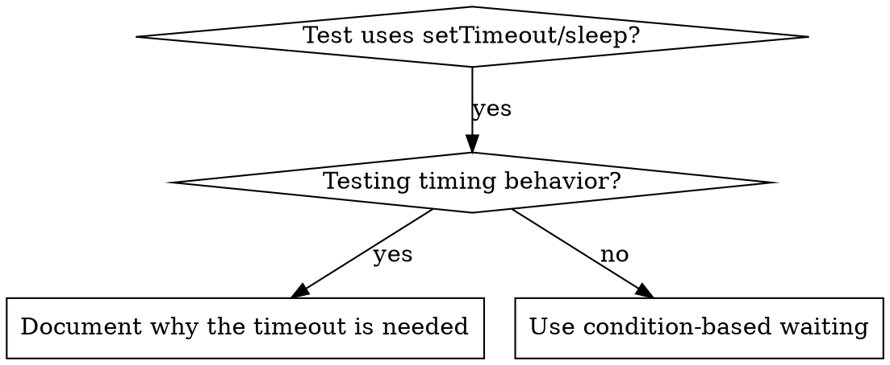

# Condition-based waiting

How to fix a flaky test that sleeps for a guessed time: wait for the condition the test cares about, with a timeout. The examples are TypeScript; the method applies to any language.

## Overview

Flaky tests often guess at timing with arbitrary delays. This creates race conditions where tests pass on fast machines but fail under load or in CI.

**Core principle:** wait for the actual condition you care about, not a guess about how long it takes.

## When to use



Use it when:

- Tests have arbitrary delays (`setTimeout`, `sleep`, `time.sleep()`).
- Tests are flaky (pass sometimes, fail under load).
- Tests time out when run in parallel.
- You are waiting for async operations to complete.

Don't use it when:

- You are testing actual timing behavior (debounce, throttle intervals).
- If you do use an arbitrary timeout, always document why.

## Core pattern

```typescript
// Before: guessing at timing
await new Promise(r => setTimeout(r, 50));
const result = getResult();
expect(result).toBeDefined();

// After: waiting for the condition
await waitFor(() => getResult() !== undefined);
const result = getResult();
expect(result).toBeDefined();
```

## Quick patterns

| Scenario | Pattern |
|----------|---------|
| Wait for event | `waitFor(() => events.find(e => e.type === 'DONE'))` |
| Wait for state | `waitFor(() => machine.state === 'ready')` |
| Wait for count | `waitFor(() => items.length >= 5)` |
| Wait for file | `waitFor(() => fs.existsSync(path))` |
| Complex condition | `waitFor(() => obj.ready && obj.value > 10)` |

## Implementation

A generic polling function:

```typescript
async function waitFor<T>(
  condition: () => T | undefined | null | false,
  description: string,
  timeoutMs = 5000
): Promise<T> {
  const startTime = Date.now();

  while (true) {
    const result = condition();
    if (result) return result;

    if (Date.now() - startTime > timeoutMs) {
      throw new Error(`Timeout waiting for ${description} after ${timeoutMs}ms`);
    }

    await new Promise(r => setTimeout(r, 10)); // Poll every 10ms
  }
}
```

See `condition-based-waiting-example.ts` in this folder for a complete implementation with domain-specific helpers (`waitForEvent`, `waitForEventCount`, `waitForEventMatch`) from an actual debugging session.

## Common mistakes

| Mistake | Fix |
|---|---|
| Polling too fast: `setTimeout(check, 1)` wastes CPU. | Poll every 10ms. |
| No timeout: the loop runs forever if the condition is never met. | Always include a timeout with a clear error. |
| Stale data: the state is cached before the loop. | Call the getter inside the loop for fresh data. |

## When an arbitrary timeout is correct

```typescript
// Tool ticks every 100ms - need 2 ticks to verify partial output
await waitForEvent(manager, 'TOOL_STARTED'); // First: wait for condition
await new Promise(r => setTimeout(r, 200));   // Then: wait for timed behavior
// 200ms = 2 ticks at 100ms intervals - documented and justified
```

Requirements:

1. First wait for the triggering condition.
2. Base the wait on known timing, not a guess.
3. Add a comment explaining why.

## Real-world impact

From a debugging session (2025-10-03):

- Fixed 15 flaky tests across 3 files.
- Pass rate: 60% to 100%.
- Execution time: 40% faster.
- No more race conditions.
