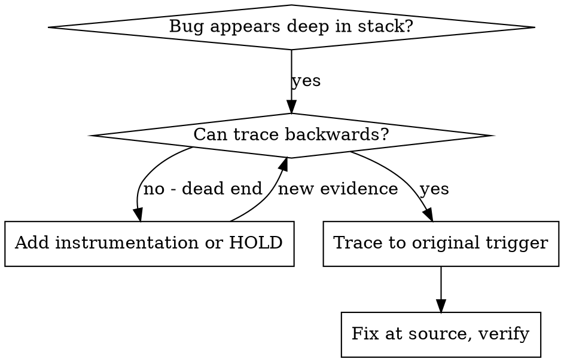
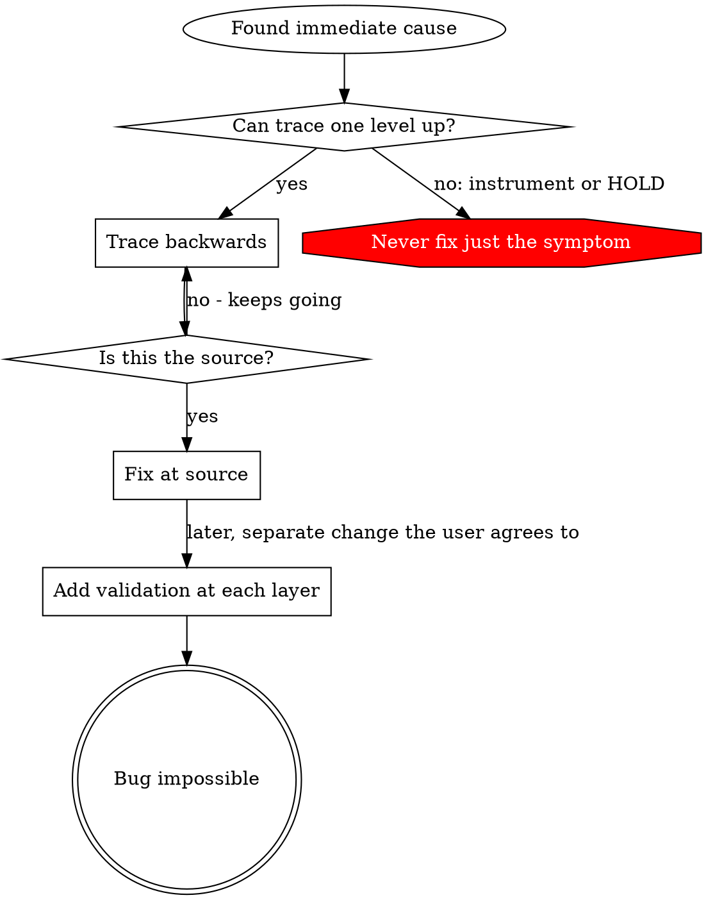

# Root cause tracing

How to trace a bug backward through the call chain to the code that first produced the bad value, and how to find which test leaves a stray file or state behind. The examples are TypeScript; the method applies to any language.

## Overview

Bugs often show up deep in the call stack (git init in the wrong directory, a file created in the wrong location, a database opened with the wrong path). Your instinct is to fix where the error appears, but that is treating a symptom.

**Core principle:** trace backward through the call chain until you find the original trigger, then fix at the source.

## When to use



At a dead end, do not fix at the symptom point. Add the stack-trace instrumentation below to get the next fact, or return a HOLD (see the HOLD table in `SKILL.md`) saying what measurement is missing.

Use it when:

- The error happens deep in execution (not at the entry point).
- The stack trace shows a long call chain.
- It is unclear where the invalid data originated.
- You need to find which test or code triggers the problem.

## The tracing process

### 1. Observe the symptom

```
Error: git init failed in ~/project/packages/core
```

### 2. Find the immediate cause

What code directly causes this?

```typescript
await execFileAsync('git', ['init'], { cwd: projectDir });
```

### 3. Ask: what called this?

```typescript
WorktreeManager.createSessionWorktree(projectDir, sessionId)
  → called by Session.initializeWorkspace()
  → called by Session.create()
  → called by test at Project.create()
```

### 4. Keep tracing up

What value was passed?

- `projectDir = ''` (an empty string).
- An empty string as `cwd` resolves to `process.cwd()`.
- That is the source code directory.

### 5. Find the original trigger

Where did the empty string come from?

```typescript
const context = setupCoreTest(); // Returns { tempDir: '' }
Project.create('name', context.tempDir); // Accessed before beforeEach!
```

## Adding stack traces

When you can't trace manually, add instrumentation:

```typescript
// Before the problematic operation
async function gitInit(directory: string) {
  const stack = new Error().stack;
  console.error('DEBUG git init:', {
    directory,
    cwd: process.cwd(),
    nodeEnv: process.env.NODE_ENV,
    stack,
  });

  await execFileAsync('git', ['init'], { cwd: directory });
}
```

In tests, use `console.error()`, not the logger: the logger may not show.

Run and capture:

```bash
npm test 2>&1 | grep 'DEBUG git init'
```

Analyze the stack traces:

- Look for test file names.
- Find the line number triggering the call.
- Identify the pattern (same test? same parameter?).

## Finding which test causes pollution

If something appears during tests (a stray `.git` folder, a leftover file) and you don't know which test creates it, bisect by running the test files one at a time:

1. Confirm the stray file or folder is absent. If it is already there, remove it first.
2. Run one test file.
3. Check whether the stray file or folder now exists.
4. If it does, that test file is the polluter: stop there. If not, go to the next test file.

The first test file after which the artefact exists is the one to trace. The loop is worth keeping as a small script that takes the artefact to look for and a glob of test files (for example `'.git' 'src/**/*.test.ts'`), runs the tests one by one and stops at the first polluter. No such script is bundled with this skill, so run the loop by hand or with the project's own test runner.

## Real example: empty projectDir

**Symptom:** `.git` created in `packages/core/` (source code).

**Trace chain:**

1. `git init` runs in `process.cwd()` because the `cwd` parameter is empty.
2. WorktreeManager is called with an empty projectDir.
3. Session.create() is passed an empty string.
4. The test accessed `context.tempDir` before beforeEach.
5. setupCoreTest() returns `{ tempDir: '' }` initially.

**Root cause:** a top-level variable initialization accessing an empty value.

**Fix:** made tempDir a getter that throws if accessed before beforeEach.

**Then, as a separate change after the fix was verified, added defense-in-depth** (see `defense-in-depth.md`):

- Layer 1: Project.create() validates the directory.
- Layer 2: WorkspaceManager validates it is not empty.
- Layer 3: a NODE_ENV guard refuses git init outside tmpdir.
- Layer 4: stack trace logging before git init.

## Key principle



Never fix just where the error appears. Trace back to find the original trigger.

## Stack trace tips

- **In tests:** use `console.error()`, not the logger; the logger may be suppressed.
- **Before the operation:** log before the dangerous operation, not after it fails.
- **Include context:** directory, cwd, environment variables, timestamps.
- **Capture the stack:** `new Error().stack` shows the complete call chain.

## Outcome of the example

For the empty `projectDir` bug above:

- Found the root cause through a 5-level trace.
- Fixed at the source (getter validation).
- Added 4 layers of defense.
- 1847 tests passed, zero pollution.
